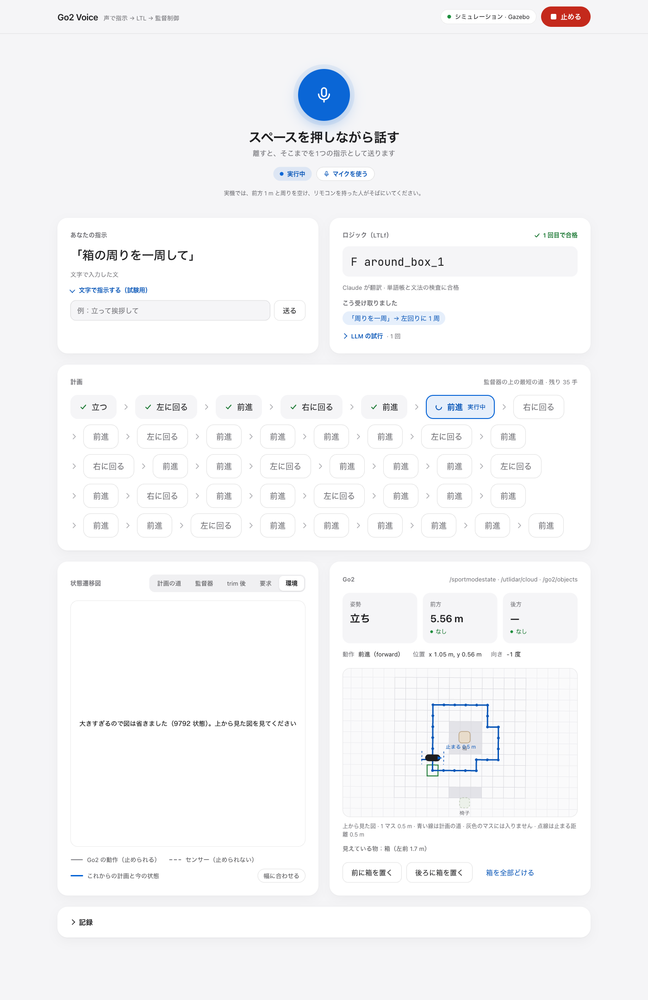

# Gazebo での物の確認：箱の一周と椅子まで（Task I）

設計書 `docs/superpowers/specs/2026-11-05-go2-objects-design.md` の §2 の合格の条件を Gazebo で測り、操作画面を本物の Claude で動かした記録。4 つに分かれる：

- **第 1 部**（計画の Task I の手順 4〜6）：`objects/i` のフォルダで、LLM を通さずに、物の一覧・RTF・箱の一周・椅子までを測った。実行器と橋渡しを調整したのもここ。
- **第 2 部**（手順 4〜7）：wave 3 を merge した後の本体のフォルダで、静かなときの RTF を測り、一周と椅子を 1 回ずつ流し、操作画面から本物の Claude で動かした（上から見た図の絵もここ）。
- **第 3 部**：実行器を 3 回変えて（`4783846`、M1 の止まらずにつなぐ動き、角もつなぐ動き）、そのたびに一周 3 回・椅子 3 回を測った。**最後のコード（`c2641ce`）で一周 2/3・椅子 3/3・挨拶つき 1/1。**
- **第 4 部**（いちばん新しい。下のすぐ次の節）：調整の回（C0〜C3、一周 5 回ずつ）で C2（旋回の後は z を 0 にしてから歩き出す、前進 0.22 m/s・旋回 0.4 rad/s）を選んで merge し、手前の帯の外側の線を 1.3 m にした（N1）。**最後のコード（`a2fe140`）で一周 2/5・椅子 3/3・挨拶つき 0/1、操作画面の一周 1/3 とそこからの椅子まで 1/1。**

- 日付：2026-11-06（第 4 部の最後の回は 2026-11-07）。場所：この Mac の Docker Desktop（arm64、CPU 8、メモリ 7.7 GiB）。
- 回は 5 つの時間帯に分かれる：
  - **第 1 部・最初の回（13:11〜14:10）**：実行器の値を変えながら 15 回の一周と 5 回の椅子。この間、別の担当（Task H・Task L）がそれぞれのフォルダでテストを流していた
    （`obj-h-app-run-*`・`obj-l-app-run-*` が 100〜120 %）。とくに 13:14 と 13:34 は重かった（下の「負荷が重いとき」）。
  - **第 1 部・修正 1 回目（14:37〜14:46）**：レビューを受けて、実行器を計画の P7 に戻し、橋渡しを直して（下の「最初の動作の速度を 0 から上げる」）、手順 5・6 の 7 回を流し直した。
    ほかのコンテナは動いていなかった（各回の `docker stats` は `go2-objects-gz` と `go2-objects-rec` だけ）。
  - **第 2 部（15:13〜15:39）**：本体のフォルダ（`~/work/physicalAI/go2`、ブランチ `feat/voice-ltl-gazebo`、commit `69aa06c`＝wave 1〜3 を merge した後）。
    実行器・橋渡しの中身は修正 1 回目と同じ。ほかのタスクは動いていなかった（`docker ps` は、自分で起動した使い捨てのコンテナだけ）。
  - **第 3 部（16:28〜17:30）**：組 A（16:28〜16:36）・組 B（17:01〜17:08）・組 C（17:23〜17:30）。中身は「第 3 部」の節。
  - **第 4 部（2026-11-06 17:46〜2026-11-07 06:52）**：調整の回（17:46〜18:36、`objects/n` のフォルダ）、`6825e2b` の回（18:48〜18:55）、最後のコード `a2fe140` の回（11-07 06:27〜06:41）と操作画面（06:42〜06:52）。間の 18:56〜06:26 は Mac のふたが閉じられて眠っていた。中身は「第 4 部」の節。
- 使ったもの：app は `go2-voice-ltl:dev`（ROS 2 Humble）、gazebo は `go2-voice-ltl-gazebo:dev`（ROS 2 Jazzy + Gazebo Harmonic、`docker/patches/` の 0001・0002 入り。作り直していない）。
  第 1 部のコードは `objects/i` のフォルダ（`../.go2-worktrees/obj-i`、compose の project は `obj-i`）。修正 1 回目は commit `97c3c64`：
  実行器（`voice_ltl/grid_executor.py`）は計画の P7 の値のまま、橋渡し（`gazebo/bridge_core.py`）は大きさの `StillGate` と、待たせた速度を 0 から上げる `RELEASE_ACC` 入り。
- Gazebo は毎回、使い捨てのコンテナで起動し直した（compose の service は起動していない。計画の P8）：

```bash
docker stop go2-objects-gz       # 前の回の、自分で起動した使い捨てのコンテナだけ
docker compose --profile gazebo run -d --rm --no-deps -T -e ROS_DOMAIN_ID=77 --name go2-objects-gz gazebo \
    ros2 launch /work/gazebo/launch/go2_gazebo.launch.py gui:=false
# ログに Configured and activated unitree_guide_controller が出るまで待つ（イメージがキャッシュにあると 8〜10 秒）
```

  計画の手順 4 は `-d` なしで後ろで動かす形。ここでは `-d`（コンテナを切り離す）にしただけで、ほかは同じ。
- 測り方：
  - `gazebo/tools/objects_check.py`。`run` は `/model/robot/odometry`（Gazebo の本当の位置と傾き）を記録しながら `run_formula` を子として流し、§2 の値と合否を JSON 1 行で出す。
  - 動作ごとの傾きは、別の使い捨てコンテナ（`go2-objects-rec`）で `gazebo/tools/motion_log.py record` を回して、odometry（25 Hz）・`/api/sport/request`・`/go2/objects` の大きさの変化を記録し、
    `motion_log.py table` で数えた（1 つの動作 = StopMove の後の最初の Move から、次の動作の最初の Move の前まで。止めた後の 0.5 秒の待ちも入る）。
    最初の回は同じ中身の道具をコミットせずに使っていた。修正 1 回目で `motion_log.py` としてコミットし、最初の回の記録も数え直した（下の「動作ごとの最大傾き」の数はどれもこの道具の出力）。
  - 橋渡しが controller に送った値は、Gazebo のコンテナのログ（`controller へ: command …`）で見た。
  - 第 2 部の操作画面は Playwright（Chromium、幅 1400）で開き、ページの文字（記録・札・図の説明）を読み、絵を撮った。

## 第 4 部：調整の回（C0〜C3）、手前の帯 1.3 m（N1）、最後の確かめ（2026-11-06 17:46〜11-07 06:52）

第 3 部の後、実行器をもう 1 回だけ調整した（`objects/n`、組 C0〜C3、一周 5 回ずつ）。選んだ C2 を merge（`6825e2b`）し、手前の帯の外側の線を 1.4 m から 1.3 m にした（ruling N1、`a2fe140`）。その後で一周・椅子・挨拶つき・操作画面を流し直した。

**最後のコード `a2fe140`（2026-11-07 06:27〜06:52）：RTF 0.98、一周 2/5（L4・L5。3 回続けては通らなかった）、椅子 3/3（1.04〜1.15 m）、挨拶つき 0/1（立った後の最初の旋回の始めで胴が落ちた）。操作画面（本物の Claude）：一周は 3 回のうち 1 回（P4）終わり、終わった所からの「椅子まで歩いて」も終わった（Review Focus 1。椅子まで 1.28 m・9°）。§2 の合格の条件（一周 3 回・椅子 3 回、転ばない）は、まだ満たしていない。** C2 のコードの一周は、`objects_check.py` の 13 回のうち 6 回（調整の回 3/5、`6825e2b` 1/3、`a2fe140` 2/5）。転ぶのは今も Gazebo の unitree_guide controller の揺れ（下の「残ること」）。

### 調整の回（`objects/n`、17:46〜18:36）

- 場所：`../.go2-worktrees/obj-n`（compose の project は `obj-n`）。Gazebo は回ごとに使い捨てのコンテナで起動し直した（`gz-n`、記録は `rec-n`）。イメージ・controller・`docker/patches/` は変えていない。ほかのコンテナは動いていなかった。
- 決まり：一周 5 回ずつ流し、動作 1 回あたりの転びがいちばん少ない組を選ぶ（「動作」は `開始：` の前進・右に回る・左に回る。立つは数えない）。
- 生の記録：`.superpowers/sdd/2026-11-05-go2-objects/gazebo-tuning.md` と、その横の `gazebo-tuning-runs/`（gitignore）。

| 組 | 変えたこと | 一周 | 動作 | 転び | 転び / 動作 | 合格した一周（巻き数 / 箱の縁 / max_tilt / 立つから結果まで） |
|---|---|---|---|---|---|---|
| C0 | 基準（`c2641ce` の実行器）：旋回の後の前進は旋回の z（±0.15 ほど）から続け、x をすぐ上げる。前進 0.3 m/s、旋回 0.5 rad/s | 1/5 | 120 | 4 | 0.0333（30 回に 1 回） | 1.057 / 0.762 / 0.861 / 68 秒 |
| C1 | C0 + 旋回 → 前進を順に：前進はまず旋回の z を 1.0 rad/s² で 0 へ下げ（x は 0、StopMove なし）、その次の周期から x を 0 から上げる | 3/5 | 149 | 2 | 0.0134（74 回に 1 回） | 1.030〜1.058 / 0.766〜0.839 / 0.709〜0.789 / 68〜105 秒 |
| **C2** | **C1 + 速さ (0.3, 0.3, 0.5) → (0.22, 0.3, 0.4)**：前進 0.22 m/s、旋回 0.4 rad/s（加速度は同じ） | **3/5** | **176** | **2** | **0.0114（88 回に 1 回）** | 1.035〜1.046 / 0.783〜0.836 / 0.510〜0.787 / 114〜129 秒 |
| C3 | C1 + 旋回だけ 0.4 rad/s（前進は 0.3 m/s のまま） | 0/5 | 80 | 5 | 0.0625（16 回に 1 回） | — |

- **C2 を選んだ**（決まりどおり、転び / 動作がいちばん少ない：C2 2/176 < C1 2/149 < C0 4/120 < C3 5/80）。いちばん遅い組で、合格した一周は 114〜129 秒（C1 は 68〜105 秒）。commit `09377c3`。
- C2 の 2 回の転び（L2 24/40、L5 36/43）は、どちらも旋回からつないだ前進：旋回が遅くなる所と z を 0 へ下げる周期で roll が育ち、x を上げた所で roll は 0.61（L2）・0.92（L5）だった。C2 の「前進からつないだ前進」（0.22 m/s）は 68 回で 0、0.3 m/s の組（C0・C1・C3）では 136 回で 2（C3 L1・L5、まっすぐ歩いている途中）。
- C1 L4 は一周を終え（`結果`）、その 1.13 秒後に立ったまま倒れた（速度 0）。`objects_check.py` が終わった後を 1 秒しか見ていなかったら合格と数えていた。
- **`objects_check.py` は、終わった後 3 秒（`TAIL_S`）まで記録する**（commit `6bf599c`、それまでは 1 秒）。調整の回 23 回と、この部の回はどれも 3 秒。
- C2 で椅子まで 3 回（`72107e9`）：2/3。N1 1.108 m・23.5°、N2 1.157 m・21.3°。N3 は転ばずに 1.539 m（§2 の 1.5 m の外）で終わった。
- 調整の回のレビューは承認（直す所は小さな指摘だけ）。小さな指摘 2 つは `a2fe140` で直した（M1 の止まるわけの文、「今は進める動作がありません」のテスト）。

### merge の判断

- 第 3 部の組 C（`c2641ce`）は一周 2/3、転び 1 / 108 動作（椅子の回も含め、`TAIL_S` 1 秒）。同じコードを `TAIL_S` 3 秒で 5 回流した C0 は一周 1/5、4 / 120。`c2641ce` の 8 回を合わせると一周 3/8、一周だけの転び 5 / 約 203 動作（41 回に 1 回）。
- C2 は一周 3/5、2 / 176（88 回に 1 回）。一周の合格の割合も、転び / 動作も、同じ測り方の `c2641ce` より良い。レビューに重い指摘（Critical・Important）は無い。**merge した（`6825e2b`）。** 遅くないテストは 1222 件すべて通った。

### 手前の帯の外側の線を 1.3 m に（ruling N1、commit `a2fe140`）

- C2 の椅子の N3 は、行き先のマスの中心が椅子から 1.395 m（R4 の帯 min(r + 1.5, 1.4) の内）だったのに、1.539 m で終わった。実行器はマスの中心から 0.15 m ほどずれて終わることがあり、1.4 m では §2 の 1.5 m まで 0.105 m しか残らない。
- そこで R4 の外側の線を min(r + 1.5, **1.3**) m にした（`voice_ltl/grid.py` の `NEAR_MAX_DISTANCE`）。§2 まで 0.2 m 残る。
- 既定の置き方（箱 50 cm 角・椅子 45 cm 角）では、どちらの物にも、中心から 1.118 m（0.5·√5）の 8 マス（向きはどれも 1 つ）の手前のマスが残る（1.414 m のマスは外れる。テスト `test_the_default_layout_keeps_near_cells_for_both_objects`）。偽の Go2 の椅子までのテストも通る。
- 気をつけること：Gazebo で測った箱の大きさが大きめ（0.523 × 0.529、r 0.372）だと、帯の内側の線 r + 0.75 = 1.122 m が 1.118 m のマスより外になる。Go2 がマスの格子にぴったり合って立っていると、`near_box_1` の手前のマスは 0 になる（1.4 m のときも同じ）。実際は立った位置と向きが数 cm・数度ずれるので 4〜6 マス残った（`grid_world` で確かめた）。「箱の前まで」は Gazebo では流していない。
- 遅くないテスト：1224 件すべて通った（`a2fe140`）。

### 最後の確かめ

コマンドは第 3 部と同じ（`objects_check.py` の `rtf --seconds 20` / `run --expect lap "F around_box_1"` / `run --expect near "F near_chair_1"` / `run --expect near "F(near_chair_1 & X F hello)"`、回ごとに使い捨ての Gazebo `gz-final` と記録 `rec-final`）。生の記録は `.superpowers/sdd/2026-11-05-go2-objects/gazebo-final-runs/`（gitignore。`final/` が `6825e2b`、`final3/` が `a2fe140`、道具は `tools/`）。

**この Mac はふたを閉じると眠る。** 18:56:28 にふたが閉じられ（`pmset -g log` の `Clamshell Sleep`）、その後はときどき短く起きるだけになった。眠っている間は Docker の VM も止まるので、Gazebo の回は実時間で走らない。眠りにかかった回は数えない（`tools/guarded.sh` は、ふたが開いている間だけ流し、`pmset -g log` に眠り・目覚めが入った回を無効にする）。

#### `6825e2b`（C2 を merge した後、N1 の前。18:48〜18:55、ふたは開いていた）

一周の動きは `a2fe140` と同じ（N1 は手前の帯だけ、レビューの直しは記録の文だけを変えた）。椅子の回は 1.4 m の帯で計画した。

| 回 | 時刻 | 式 | 結果 | 値 |
|---|---|---|---|---|
| R1 | 18:48:38 | — | RTF **0.97** | — |
| L1 | 18:49:09 | `F around_box_1` | 不合格（転んだ） | 14/41 動作目の左に回る（前進からつないだ角）、回り始めて 0.77 秒、橋渡しの roll −1.03、max_tilt 1.039 |
| L2 | 18:50:13 | `F around_box_1` | **合格** | 巻き数 1.046、箱の縁 0.777 m、max_tilt 0.964、40/40 動作 |
| L3 | 18:52:49 | `F around_box_1` | 不合格（転んだ） | 2/41 動作目の左に回る（立った後）、6.88 秒、roll +1.15、max_tilt 3.125 |
| N1 | 18:53:23 | `F near_chair_1` | **合格** | 椅子まで 1.172 m・21.0°、max_tilt 0.892 |
| N2 | 18:54:10 | `F near_chair_1` | **合格** | 1.093 m・22.8°、0.416 |
| N3 | 18:54:52 | `F near_chair_1` | **合格** | 1.015 m・25.6°、0.489 |
| H1 | 18:55:35 | `F(near_chair_1 & X F hello)` | （合格と出たが数えない） | 1.301 m・21.3°、0.622。走っている間（18:56:28）にふたが閉じられ、結果は 19:02:30 |

- 一周 1/3（動作 53 回で転び 2）、椅子 3/3（動作 19 回で 0）。
- L1 の転びは「前進 → 旋回の角」で、第 3 部の組 C（25 回）・調整の回の C2（48 回）では 0 だった所。L3 は立った後の最初の旋回（C1 L2・C3 L4 と同じ所）。

```text
# R1 18:48:38
{"rtf": 0.97}
# L1 18:49:09
{"formula": "F around_box_1", "expect": "lap", "exit_code": 1, "first_action": "立つ", "winding_box_1": 0.209, "min_edge_box_1": 0.978, "min_edge_chair_1": 1.11, "final_dist_chair_1": 1.512, "final_angle_chair_1_deg": 120.5, "max_tilt": 1.039, "passed": false, "failures": ["winding: 0.209 not in [0.9, 1.5)", "max_tilt: 1.039 >= 1", "exit_code: 1 != 0"], "samples": 2402}
# L2 18:50:13
{"formula": "F around_box_1", "expect": "lap", "exit_code": 0, "first_action": "立つ", "winding_box_1": 1.046, "min_edge_box_1": 0.777, "min_edge_chair_1": 1.139, "final_dist_chair_1": 2.011, "final_angle_chair_1_deg": 44.1, "max_tilt": 0.964, "passed": true, "failures": [], "samples": 6291}
# L3 18:52:49
{"formula": "F around_box_1", "expect": "lap", "exit_code": 1, "first_action": "立つ", "winding_box_1": 0.098, "min_edge_box_1": 2.242, "min_edge_chair_1": 1.068, "final_dist_chair_1": 1.293, "final_angle_chair_1_deg": 37.7, "max_tilt": 3.125, "passed": false, "failures": ["winding: 0.098 not in [0.9, 1.5)", "max_tilt: 3.125 >= 1", "exit_code: 1 != 0"], "samples": 763}
# N1 18:53:23
{"formula": "F near_chair_1", "expect": "near", "exit_code": 0, "first_action": "立つ", "winding_box_1": 0.099, "min_edge_box_1": 2.401, "min_edge_chair_1": 0.823, "final_dist_chair_1": 1.172, "final_angle_chair_1_deg": 21.0, "max_tilt": 0.892, "passed": true, "failures": [], "samples": 1504}
# N2 18:54:10
{"formula": "F near_chair_1", "expect": "near", "exit_code": 0, "first_action": "立つ", "winding_box_1": 0.125, "min_edge_box_1": 1.129, "min_edge_chair_1": 0.775, "final_dist_chair_1": 1.093, "final_angle_chair_1_deg": 22.8, "max_tilt": 0.416, "passed": true, "failures": [], "samples": 1265}
# N3 18:54:52
{"formula": "F near_chair_1", "expect": "near", "exit_code": 0, "first_action": "立つ", "winding_box_1": 0.128, "min_edge_box_1": 1.073, "min_edge_chair_1": 0.692, "final_dist_chair_1": 1.015, "final_angle_chair_1_deg": 25.6, "max_tilt": 0.489, "passed": true, "failures": [], "samples": 1327}
# H1 18:55:35（ふたが閉じられて眠った回。数えない）
{"formula": "F(near_chair_1 & X F hello)", "expect": "near", "exit_code": 0, "first_action": "立つ", "winding_box_1": 0.109, "min_edge_box_1": 1.019, "min_edge_chair_1": 0.991, "final_dist_chair_1": 1.301, "final_angle_chair_1_deg": 21.3, "max_tilt": 0.622, "passed": true, "failures": [], "samples": 1453}
```

#### `a2fe140`（最後のコード。2026-11-07 06:27〜06:41）

- 2026-11-07 02:54 に一度流し始めたが、Mac は眠っていて（ふたが閉じていた）、R1 は controller が 180 秒で起動せず、L1 は走り始めた 3 秒後に Mac が眠った。どちらも止めて数えない。
- 06:26 にふたが開き、`tools/run_all3.sh`（`guarded.sh` で包んだ `run_one.sh`）が流した。10 回とも `pmset -g log` に眠り・目覚めが入っていない（`VALID`）。
- 負荷：ほかのコンテナは無し。`gz-final` は 170〜280 %。Mac の 1 分の loadavg は、目覚めた直後の R1・L1 で 13〜15、L2 で 6〜11、その後は 4〜7。

| 回 | 時刻 | 式 | 計画 | 結果 | 値 |
|---|---|---|---|---|---|
| R1 | 06:27:01 | — | — | RTF **0.98** | — |
| L1 | 06:27:56 | `F around_box_1` | 41 | 不合格（転んだ） | 11/41 動作目の前進（左に回ってつないだ）、歩き出して 0.34 秒、橋渡しの roll −1.12、max_tilt 3.142（箱の縁 0.276 m は転んだ後に転がった位置） |
| L2 | 06:29:15 | `F around_box_1` | 41 | 不合格（止まった） | 14/41 動作目の左に回る（前進からつないだ角）。傾き 0.995 まで揺れ、旋回の終わりの位置合わせで「位置がずれたので止めました」（R11）。転んではいない |
| L3 | 06:30:47 | `F around_box_1` | 41 | 不合格（転んだ） | 5/41 動作目の前進（右に回ってつないだ。組 C の L1 と同じ所）、0.46 秒、roll +1.04、max_tilt 3.142 |
| L4 | 06:31:50 | `F around_box_1` | 41 | **合格** | 巻き数 1.042、箱の縁 0.822 m、max_tilt 0.597、立つから結果まで 126 秒 |
| L5 | 06:34:39 | `F around_box_1` | 41 | **合格** | 巻き数 1.042、箱の縁 0.784 m、max_tilt 0.473、120 秒 |
| N1 | 06:37:25 | `F near_chair_1` | 8：右 → 前進 ×2 → 左 → 前進 ×3 | **合格** | 椅子まで 1.121 m・24.2°、max_tilt 0.512 |
| N2 | 06:38:35 | `F near_chair_1` | 8：同上 | **合格** | 1.150 m・24.0°、0.664 |
| N3 | 06:39:44 | `F near_chair_1` | 7：前進 ×4 → 右 → 前進 | **合格** | 1.043 m・15.7°、0.828 |
| H1 | 06:40:50 | `F(near_chair_1 & X F hello)` | 9 | 不合格（転んだ） | 2/9 動作目の右に回る（立った後の最初の旋回）。controller が「歩く」に入った（`error_code 1013 → 1015`）0.15 秒後に胴の高さが 0.14 m になり（橋渡しの「伏せ扱い」）、旋回の Move は controller に届いていない。max_tilt 0.786。調整の回の C3 L4 と同じ形 |

- 一周 2/5（動作 107 回で、転び 2・位置のずれで止まった 1）。椅子 3/3（動作 20 回で 0）。挨拶つき 0/1。計画の大きさ：手順 4 の大きさはどの回も箱 0.511 × 0.514〜0.515・椅子 0.469 × 0.467。
- 椅子の 3 回は 1.04〜1.15 m で、N1 の前の 1.4 m の帯で 1.539 m になった形は出なかった（帯は 1.3 m まで）。
- 一周の失敗 3 回は、旋回からつないだ前進の歩き出し 2（L1・L3）と、角の旋回 1（L2）。どれも調整の回・第 3 部で見た所。

```text
# R1 06:27:01
{"rtf": 0.98}
# L1 06:27:56
{"formula": "F around_box_1", "expect": "lap", "exit_code": 1, "first_action": "立つ", "winding_box_1": 0.053, "min_edge_box_1": 0.276, "min_edge_chair_1": 1.374, "final_dist_chair_1": 2.471, "final_angle_chair_1_deg": 101.2, "max_tilt": 3.142, "passed": false, "failures": ["winding: 0.053 not in [0.9, 1.5)", "min_edge_box_1: 0.276 < 0.6", "max_tilt: 3.142 >= 1", "exit_code: 1 != 0"], "samples": 2009}
# L2 06:29:15
{"formula": "F around_box_1", "expect": "lap", "exit_code": 1, "first_action": "立つ", "winding_box_1": 0.185, "min_edge_box_1": 0.951, "min_edge_chair_1": 0.867, "final_dist_chair_1": 1.155, "final_angle_chair_1_deg": 172.2, "max_tilt": 0.995, "passed": false, "failures": ["winding: 0.185 not in [0.9, 1.5)", "exit_code: 1 != 0"], "samples": 2535}
# L3 06:30:47
{"formula": "F around_box_1", "expect": "lap", "exit_code": 1, "first_action": "立つ", "winding_box_1": -0.008, "min_edge_box_1": 2.207, "min_edge_chair_1": 2.335, "final_dist_chair_1": 2.998, "final_angle_chair_1_deg": 13.0, "max_tilt": 3.142, "passed": false, "failures": ["winding: -0.008 not in [0.9, 1.5)", "max_tilt: 3.142 >= 1", "exit_code: 1 != 0"], "samples": 1146}
# L4 06:31:50
{"formula": "F around_box_1", "expect": "lap", "exit_code": 0, "first_action": "立つ", "winding_box_1": 1.042, "min_edge_box_1": 0.822, "min_edge_chair_1": 1.192, "final_dist_chair_1": 2.216, "final_angle_chair_1_deg": 61.8, "max_tilt": 0.597, "passed": true, "failures": [], "samples": 6521}
# L5 06:34:39
{"formula": "F around_box_1", "expect": "lap", "exit_code": 0, "first_action": "立つ", "winding_box_1": 1.042, "min_edge_box_1": 0.784, "min_edge_chair_1": 1.133, "final_dist_chair_1": 2.194, "final_angle_chair_1_deg": 59.9, "max_tilt": 0.473, "passed": true, "failures": [], "samples": 6265}
# N1 06:37:25
{"formula": "F near_chair_1", "expect": "near", "exit_code": 0, "first_action": "立つ", "winding_box_1": 0.102, "min_edge_box_1": 2.383, "min_edge_chair_1": 0.81, "final_dist_chair_1": 1.121, "final_angle_chair_1_deg": 24.2, "max_tilt": 0.512, "passed": true, "failures": [], "samples": 1515}
# N2 06:38:35
{"formula": "F near_chair_1", "expect": "near", "exit_code": 0, "first_action": "立つ", "winding_box_1": 0.1, "min_edge_box_1": 2.328, "min_edge_chair_1": 0.826, "final_dist_chair_1": 1.15, "final_angle_chair_1_deg": 24.0, "max_tilt": 0.664, "passed": true, "failures": [], "samples": 1514}
# N3 06:39:44
{"formula": "F near_chair_1", "expect": "near", "exit_code": 0, "first_action": "立つ", "winding_box_1": 0.139, "min_edge_box_1": 1.076, "min_edge_chair_1": 0.741, "final_dist_chair_1": 1.043, "final_angle_chair_1_deg": 15.7, "max_tilt": 0.828, "passed": true, "failures": [], "samples": 1302}
# H1 06:40:50
{"formula": "F(near_chair_1 & X F hello)", "expect": "near", "exit_code": 1, "first_action": "立つ", "winding_box_1": -0.007, "min_edge_box_1": 2.419, "min_edge_chair_1": 2.555, "final_dist_chair_1": 2.951, "final_angle_chair_1_deg": 33.3, "max_tilt": 0.786, "passed": false, "failures": ["final_dist_chair_1: 2.951 > 1.5", "exit_code: 1 != 0"], "samples": 475}
```

#### 操作画面（本物の Claude）

第 2 部の手順 7 と同じ形（Gazebo を起動し直し、`SIM_KIND=gazebo`・`GO2_UI_PORT=8811`・`-p 127.0.0.1:8811:8000` で app のサーバー `ui-final`、記録 `rec-final`。回ごとに 3 つとも止めて起動し直した）。
Playwright（Chromium、幅 1400）で http://localhost:8811 を開き、「文字で指示する（試験用）」に「箱の周りを一周して」を入れて送った。最大 3 回（転んだら次の回）。生の記録は `gazebo-final-runs/page/`。

| 回 | 時刻 | 式（Claude） | 監督器 | 結果 |
|---|---|---|---|---|
| P1 | 2026-11-06 19:09（`6825e2b`） | — | — | 数えない：ふたが閉じられて眠っている間に起動し、ページが開くのを待つ所で時間切れ（コンテナのログには `ページ: http://localhost:8811` が出ていた）。本物の Claude には何も送っていない |
| P2 | 2026-11-07 06:42:25（`5f90ebb`、コードは `a2fe140`） | `F around_box_1`（4.4 秒、「1 回目で合格」） | 9408 | 34/41 動作目の左に回る（前進からつないだ角）、回り始めて 4.5 秒で転んだ（roll −1.05）。「続けられませんでした 姿勢が変わったので止めました。」 |
| P3 | 06:45:21 | 同上（4.0 秒） | 9600 | 計画 39 動作。32 動作目の左に回るで Go2 が横に流れ、旋回の終わりの位置合わせが 1 つ外側のマスへ移った（`(2, 6),3 -> (2, 7),3`。R10 のとおり監督器も移り、次の左に回るの前に M1 の StopMove：「turn_left(90度) は turn_left(90度) の続きではありません」）。その後も 2 回、隣のマスへの位置合わせがあり、移った先からの計画で周回の進みがやり直しになって、計画が伸びた。54 動作目の前進（左に回ってつないだ）の歩き出しで転んだ（約 1 秒、roll −1.13）。一周は終わっていない |
| **P4** | 06:49:11 | 同上（4.0 秒） | 9552 | **終わりました**（41/41 動作、立つから 122 秒、06:51:19）。終わった所：odometry (1.49, 0.35)、向き −1.5°。札は「見えている物：箱（左前 1.5 m）」 |

- どの回も、ロジック `F around_box_1`、「1 回目で合格」「Claude が翻訳 · 単語帳と文法の検査に合格」、こう受け取りました「「周りを一周」→ 左回りに 1 周」。上から見た図に箱・椅子・マス・灰色のふさがったマス・青い道（「計画の道 31 手」など）が出た。
- **Review Focus 1（一周を終えた所から「椅子まで歩いて」）：終わった。** P4 の後、そのまま「椅子まで歩いて」を送った（06:51:29）。
  - 式 `F near_chair_1`（3.7 秒）、監督器 2430 状態、計画「右に回る → 前進 → 前進 → 前進 → 左に回る」、**終わりました**（06:51:48）。
  - 終わったとき：odometry (1.300, −1.058)、向き −11.2° → 椅子 (2.5, −1.5) まで **1.279 m・9.0°**（≤ 1.5 m、≤ 45°）。札は「見えている物：椅子（前 1.3 m）」。30 秒後（足踏みの後）は (1.307, −1.085)、−2.5° で 1.263 m・16.7°。
  - 原点から離れ、輪の終わり（向きはほぼ 0°）から、その場所と向きに合わせた格子で計画し直して着いた。第 2 部で確かめられなかった「一周を終えた所から」は、これで Gazebo でも 1 回確かめた。
- ブラウザのコンソールのエラーは、サーバーを止めた後の WebSocket のつなぎ直しだけ。



絵は P2 の 16 動作目（右に回る）の途中：位置 x 2.94 m, y 0.39 m、向き 73 度、「後方 1.78 m」。箱は実線（いま見えている）、椅子は点線（覚えている）、青い道は残りの計画、緑の枠は行き先のマス。図の下は「見えている物：箱（左前 1.2 m）」。左は計画の道の図（監督器の状態 2313 から）。

### 残ること

- **§2 の合格の条件（一周 3 回・椅子 3 回、転ばない）は、まだ満たしていない。** 最後のコードで一周 2/5（3 回続けては通らない）、椅子 3/3。C2 のコードの一周は `objects_check.py` の 13 回のうち 6 回、操作画面では 3 回のうち 1 回。
- **転ぶのは今も Gazebo の unitree_guide controller の揺れ。** 最後のコードの失敗は、旋回が遅くなる所から始まる横の揺れの中での前進の歩き出し（L1・L3・P3）、角の旋回（L2・P2）、立った後の最初の旋回の始めの胴の落ち込み（H1）。旋回で横に流れて隣のマスへ移ることもある（P3）。L2 は角の旋回で揺れて位置がずれ、「位置がずれたので止めました」で止まった（隣のマスへは移っていない。その旋回の間に「前方に物が出た」の短い待ちが 2 回あった）。止まる所を減らし（M1・角）、旋回と歩き出しを順にし、遅くして（C2）、C2 のコード全体の転びは 336 動作に 6 回（およそ 56 動作に 1 回。組ごとには 26〜88 動作に 1 回で、`6825e2b` の組は C0 の 30 動作に 1 回より悪い）。減りはしたが、無くならない。翻訳・監督器・計画・Session は、転ぶまでどの回も計画どおりだった。
- **残る手は controller にパッチを当ててイメージを作り直すこと**（例：歩く間の横の揺れを抑える、旋回の終わり・歩き出しの足の運びを変える）。このタスクの決まり（イメージを作り直さない、`docker/patches` を変えない）ではしていない。やるかどうかは利用者の判断を待つ。
- 箱の手前のマスの余白（上の「手前の帯の外側の線を 1.3 m に」の「気をつけること」）。「箱の前まで」は Gazebo で流していない。
- この Mac はふたを閉じると眠り、Gazebo の回は流せない（2026-11-06 18:56〜2026-11-07 06:26）。長く流すときはふたを開けたまま、電源につないでおく。

## 第 3 部：止まる回数を減らした後（2026-11-06 16:28〜17:30）

第 2 部の後で実行器を 3 回変え、そのたびに一周 3 回・椅子 3 回を `objects_check.py` で測った（組 A・B・C）。組 C は最後のコードで、`F(near_chair_1 & X F hello)` も 1 回流した。

- どの回も Gazebo を使い捨てのコンテナで起動し直し（画面なし `gui:=false`）、手順 4（`objects`、R1 だけ `rtf --seconds 20`）の後に `motion_log.py record` を並べて `objects_check.py run` を流し、走った後にもう一度 `objects` を流した。
  コマンドは第 2 部の手順 4〜6 と同じで、コンテナの名前だけ違う（組 A `gz-go2`・`rec-go2`、組 B `gz-obj-m`・`rec-obj-m`、組 C `gz-go2-corners`・`rec-go2-corners`）。controller が起動するまで 6〜9 秒。
- 組 A・C は本体のフォルダ（`feat/voice-ltl-gazebo`）。組 B は `objects/m` のフォルダ（`../.go2-worktrees/obj-m`、compose の project は `obj-m`）。イメージは作り直していない。controller・橋渡しは第 2 部と同じ。
- 転んだ時刻は、Gazebo のコンテナのログの橋渡しの `伏せ扱い（error_code 1001）…`（|roll| か |pitch| が 1.0 rad を越えた所）。「StopMove の N 秒後」は、その時刻から記録（`motion_log.py`）の直前の StopMove までの実際の時間。
- 下の JSON の塊の `$ … objects_check.py` は `docker compose run --rm --no-deps -T -e ROS_DOMAIN_ID=77 app python3 gazebo/tools/objects_check.py` を縮めたもの（`run` には `-e SIM_KIND=gazebo` も付く）。`#` の行の時刻は、その回の Gazebo を起動した時刻。
- 生の記録（gitignore の `.superpowers/sdd/2026-11-05-go2-objects/` の下）：組 A `gazebo-measure-go2-runs/`、組 B `gazebo-measure-obj-m-runs/`、組 C `gazebo-measure-corners-runs/`（回ごとの `result.json`・`run.err`・`motion.jsonl`・`gz.log`、流した道具、数えた道具）。

### 変えたこと

| 組 | commit | 変えたこと |
|---|---|---|
| A | `4783846`（`f590bdd` で測った） | `GridExecutor.load()` が加速を 0 からやり直す。何も送らない間の後の最初の Move が 1 周期で全速（0.3 m/s・0.5 rad/s）になっていたのを直した（最終レビューの Important 2。上の「結論」の下） |
| B | M1：`a730c0d`（`objects/m`。後で merge `c22c94f`） | 続く前進は StopMove なしでつなぐ（マスの中心を 0.3 m/s のまま過ぎる）。旋回の次が前進なら、旋回は StopMove なしで終わり、前進は旋回の z（±0.15 rad/s ほど）から続けて歩き出す。止めるのはまっすぐの列の終わり（曲がる前と計画の終わり）だけ。止めた後の待ち `GRID_SETTLE_S` は 0.5 → 0.2 秒 |
| C | 角：`c2641ce`（最後のコード） | 前進の次が、その前進が着くマスでの旋回なら、それもつなぐ。前進は今までどおり行き先の手前で遅くなり（終わりは 0.08 m/s ほど）、StopMove も待ちもなしに 1 手を終え、旋回はその速さから続ける（x を 0 へ下げながら z を上げる）。旋回 → 旋回はつながない。計画が変わって全速で過ぎた前進の後に旋回が来たときは、今までどおり先に StopMove。これで、前進と 1 回ずつの旋回だけの計画は、終わりで 1 回だけ止まる |

C にしたわけ：組 A・B の転び 7 回のうち、旋回の 3 回（A L1、B L2・L3）はどれも「まっすぐの列の終わりの StopMove の後の旋回」で、z が 0.5 rad/s に上がった所（回り始めて 0.6〜0.9 秒）で倒れた。B で残った StopMove はこの所だけだった。B の動作ごとの傾きでも、StopMove の後の旋回（21 回、上位 10 % 0.91、転んだ 2）が、つないだ前進（50 回、上位 10 % 0.52〜0.56、転んだ 1）より悪かった。止まってから動き出す所が転びやすいのは第 1 部・第 2 部と同じ。

### 結果

| 組 | 時刻 | RTF（R1、20 秒） | 一周 | 椅子 | 挨拶つき | 実行器の StopMove（終えた回） | 転んだ動作 / 動作 |
|---|---|---|---|---|---|---|---|
| A（`f590bdd`、4783846 入り） | 16:28〜16:36 | 0.87 | 0/3 | 2/3 | — | 1 動作ごと（椅子 6〜7 回） | 4 / 66 |
| B（`a730c0d`、M1） | 17:01〜17:08 | 0.94 | 0/3 | **3/3** | — | まっすぐの列ごと（椅子 2 回） | 3 / 77 |
| **C（`c2641ce`、M1 + 角）** | 17:23〜17:30 | **1.0** | **2/3** | **3/3** | **1/1** | **計画の終わりの 1 回だけ** | **1 / 108** |

- **§2 の合格の条件（一周 3 回・椅子 3 回、転ばない）は、最後のコードでもまだ満たしていない：一周は 3 回のうち 2 回（L2・L3）。** 椅子は 3/3、挨拶つきは 1/1（「開始：挨拶」「完了：挨拶」まで）。
  一周の 1 回（C L1）は 5/41 動作目、旋回の後の前進の歩き出しで転んだ（下）。一周を最後まで終えたのは、この記録の全部で 34 回のうち 3 回（第 1 部 lap1、C L2・L3）。
- 組 B は、一周 0/3 が組 A と同じで、椅子 3/3 が組 A の 2/3 以上。レビューは承認で、残っていたのは小さな指摘だけだったので、merge した（`c22c94f`）。その上に C を入れた。
- 組 C の 2 回の一周：巻き数 1.040・1.036、箱の縁まで 0.758・0.828 m、`max_tilt` 0.818・0.842、立つから終わりまで 98・105 秒（実際の時間）。走った後 3 秒あまりの記録でも、傾きは 0.45 以下で立っていた。
- 組 C の 25 回の角（前進 → 旋回、StopMove なし）で、旋回の最初の Move は前進の最後の速さ（x の中央値 0.08、最大 0.15 m/s）、x は 0.1〜0.27 秒で 0 になり、z が上がった。速さ 0 で待つ周期・StopMove は無かった。
  旋回の後の前進（M1）は、旋回の z から続けて x を 0.06 ずつ上げた。実行器の StopMove は、終えた 6 回とも計画の終わりの 1 回だけ（L3 はほかに、センサーが途切れた一時停止で 1 回）。記録の StopMove がこれより 3 回多いのは、`run_formula` が終わるときに送る分。
- 動作ごとの最大傾き（`開始：` から次の `開始：` まで、max(|roll|, |pitch|)。立つを除く。M1 の後は `motion_log.py table` の「動作」（StopMove で区切る）が一周まるごとになるので、`開始：` で区切った）：

| 組 | 動作 / 始まり方 | 数 | 中央値 | 上位 10 % | 0.5〜1.0 | 転んだ |
|---|---|---|---|---|---|---|
| A | 前進 / StopMove の後 | 43 | 0.27 | 0.61 | 3 | 3（L2#21・L3#22・N3#4） |
| A | 旋回 / StopMove の後 | 17 | 0.36 | 0.73 | 4 | 1（L1#10） |
| A | 旋回 / 立った後 | 5 | 0.52 | 0.90 | 3 | 0 |
| B | 前進 / 前進からつないだ | 28 | 0.34 | 0.56 | 4 | 1（L1#27） |
| B | 前進 / 旋回からつないだ | 22 | 0.34 | 0.52 | 3 | 0 |
| B | 旋回 / StopMove の後 | 21 | 0.37 | 0.91 | 4 | 2（L2#10・L3#25） |
| C | 前進 / 前進からつないだ | 46 | 0.31 | 0.46 | 4 | 0 |
| C | 前進 / 旋回からつないだ | 29 | 0.21 | 0.57 | 2 | 1（L1#5） |
| C | 旋回 / 前進からつないだ（角） | 25 | 0.31 | 0.49 | 2 | 0 |
| C | 旋回 / StopMove の後 | 1 | 0.58 | 0.58 | 1 | 0 |

  （B の「立った後」は前進 3・旋回 3、C は前進 3・旋回 4 で、どれも転んでいない。C の「旋回 / StopMove の後」は L3 の一時停止の後の 1 回。）
- 3 回ずつは少ないので、組の間の差をはっきりとは言えない。言えるのは、C では止まってから動き出す所がほぼ無くなり（一周で 1 回）、旋回で転んだ回が無く、一周を 2 回終えたことまで。

### 組 C（最後のコード `c2641ce`、17:23〜17:30）

| 回 | 時刻 | 式 | 計画 | 結果 | 値 | 動作 | 手順 4 の大きさ（箱 / 椅子） | 走った後の大きさ |
|---|---|---|---|---|---|---|---|---|
| R1 | 17:23:09 | — | — | RTF **1.0** | — | — | 0.511×0.527 / 0.462×0.449 | — |
| L1 | 17:23:50 | `F around_box_1` | 41 | 不合格：winding、max_tilt、exit_code（転んだ：旋回の後の前進の歩き出し） | 回転数 −0.100、箱の縁 2.178 m、max_tilt 3.096 | 5/41 | 0.511×0.514 / 0.469×0.467 | 0.511×0.526 / 0.469×0.471 |
| L2 | 17:24:25 | `F around_box_1` | 40 | **合格** | 回転数 1.040、箱の縁 0.758 m、椅子の縁 1.268 m、max_tilt 0.818 | 40/40 | 0.511×0.527 / 0.462×0.454 | 0.512×0.527 / 0.462×0.466 |
| L3 | 17:26:23 | `F around_box_1` | 41 | **合格** | 回転数 1.036、箱の縁 0.828 m、椅子の縁 1.099 m、max_tilt 0.842 | 41/41 | 0.511×0.514 / 0.469×0.467 | 0.517×0.529 / 0.469×0.478 |
| N1 | 17:28:27 | `F near_chair_1` | 7：前進 ×4 → 右 → 前進 | **合格** | 椅子まで 1.142 m・26.2°、椅子の縁 0.805 m、max_tilt 0.628 | 7/7 | 0.5×0.5 / 0.5×0.5（測る前） | 0.512×0.527 / 0.462×0.477 |
| N2 | 17:29:03 | `F near_chair_1` | 7：前進 ×5 → 右 | **合格** | 椅子まで 1.369 m・2.6°、椅子の縁 1.066 m、max_tilt 0.46 | 7/7 | 0.514×0.515 / 0.469×0.454 | 0.515×0.515 / 0.469×0.458 |
| N3 | 17:29:39 | `F near_chair_1` | 8：右 → 前進 ×2 → 左 → 前進 ×3 | **合格** | 椅子まで 1.14 m・24.4°、椅子の縁 0.808 m、max_tilt 0.411 | 8/8 | 0.511×0.515 / 0.469×0.467 | 0.514×0.527 / 0.469×0.471 |
| H1 | 17:30:18 | `F(near_chair_1 & X F hello)` | 8：前進 ×4 → 右 → 前進 → 挨拶 | **合格**（「開始：挨拶」「完了：挨拶」） | 椅子まで 1.071 m・25.3°、椅子の縁 0.763 m、max_tilt 0.513 | 8/8 | 0.5×0.5 / 0.5×0.5（測る前） | 0.511×0.527 / 0.462×0.466 |

「計画」は立つを含む動作の数、「動作」は `開始：` の数 / 計画の動作の数。どの回も最初の動作は「立つ」。椅子の 3 回の計画が違うのは、立った向きと測った大きさの少しの違いで道の選び方が変わったため（どれも R4 の帯の中に着いた）。

```text
# R1 17:23:09
$ … objects_check.py objects
{"frame": "odom", "stamp": 1793953397.8684564, "objects": [{"id": "box_1", "label": "box", "x": 2.5, "y": 1.5, "size": [0.511, 0.527], "seen": 1793953397.695, "visible": true}, {"id": "chair_1", "label": "chair", "x": 2.5, "y": -1.5, "size": [0.462, 0.449], "seen": 1793953397.695, "visible": true}]}
$ … objects_check.py rtf --seconds 20
{"rtf": 1.0}
# L1 17:23:40
$ … objects_check.py objects                       # 走る前
{"frame": "odom", "stamp": 1793953427.5909834, "objects": [{"id": "box_1", "label": "box", "x": 2.5, "y": 1.5, "size": [0.511, 0.514], "seen": 1793953427.397, "visible": true}, {"id": "chair_1", "label": "chair", "x": 2.5, "y": -1.5, "size": [0.469, 0.467], "seen": 1793953427.397, "visible": true}]}
$ … objects_check.py run --expect lap "F around_box_1"; echo "exit=$?"
{"formula": "F around_box_1", "expect": "lap", "exit_code": 1, "first_action": "立つ", "winding_box_1": -0.1, "min_edge_box_1": 2.178, "min_edge_chair_1": 2.536, "final_dist_chair_1": 4.088, "final_angle_chair_1_deg": 115.3, "max_tilt": 3.096, "passed": false, "failures": ["winding: -0.100 not in [0.9, 1.5)", "max_tilt: 3.096 >= 1", "exit_code: 1 != 0"], "samples": 951}
exit=1
$ … objects_check.py objects                       # 走った後
{"frame": "odom", "stamp": 1793953452.5911367, "objects": [{"id": "box_1", "label": "box", "x": 2.5, "y": 1.5, "size": [0.511, 0.526], "seen": 1793953452.447, "visible": true}, {"id": "chair_1", "label": "chair", "x": 2.5, "y": -1.5, "size": [0.469, 0.471], "seen": 1793953449.604, "visible": false}]}
# L2 17:24:14
$ … objects_check.py objects                       # 走る前
{"frame": "odom", "stamp": 1793953462.3554168, "objects": [{"id": "box_1", "label": "box", "x": 2.5, "y": 1.5, "size": [0.511, 0.527], "seen": 1793953462.296, "visible": true}, {"id": "chair_1", "label": "chair", "x": 2.5, "y": -1.5, "size": [0.462, 0.454], "seen": 1793953462.296, "visible": true}]}
$ … objects_check.py run --expect lap "F around_box_1"; echo "exit=$?"
{"formula": "F around_box_1", "expect": "lap", "exit_code": 0, "first_action": "立つ", "winding_box_1": 1.04, "min_edge_box_1": 0.758, "min_edge_chair_1": 1.268, "final_dist_chair_1": 2.087, "final_angle_chair_1_deg": 39.5, "max_tilt": 0.818, "passed": true, "failures": [], "samples": 4977}
exit=0
$ … objects_check.py objects                       # 走った後
{"frame": "odom", "stamp": 1793953570.3557065, "objects": [{"id": "box_1", "label": "box", "x": 2.5, "y": 1.5, "size": [0.512, 0.527], "seen": 1793953557.971, "visible": false}, {"id": "chair_1", "label": "chair", "x": 2.5, "y": -1.5, "size": [0.462, 0.466], "seen": 1793953570.325, "visible": true}]}
# L3 17:26:11
$ … objects_check.py objects                       # 走る前
{"frame": "odom", "stamp": 1793953580.5328524, "objects": [{"id": "box_1", "label": "box", "x": 2.5, "y": 1.5, "size": [0.511, 0.514], "seen": 1793953580.416, "visible": true}, {"id": "chair_1", "label": "chair", "x": 2.5, "y": -1.5, "size": [0.469, 0.467], "seen": 1793953580.416, "visible": true}]}
$ … objects_check.py run --expect lap "F around_box_1"; echo "exit=$?"
{"formula": "F around_box_1", "expect": "lap", "exit_code": 0, "first_action": "立つ", "winding_box_1": 1.036, "min_edge_box_1": 0.828, "min_edge_chair_1": 1.099, "final_dist_chair_1": 2.243, "final_angle_chair_1_deg": 58.7, "max_tilt": 0.842, "passed": true, "failures": [], "samples": 5246}
exit=0
$ … objects_check.py objects                       # 走った後
{"frame": "odom", "stamp": 1793953695.0331974, "objects": [{"id": "box_1", "label": "box", "x": 2.5, "y": 1.5, "size": [0.517, 0.529], "seen": 1793953694.946, "visible": true}, {"id": "chair_1", "label": "chair", "x": 2.5, "y": -1.5, "size": [0.469, 0.478], "seen": 1793953693.487, "visible": false}]}
# N1 17:28:16
$ … objects_check.py objects                       # 走る前
{"frame": "odom", "stamp": 1793953703.8682387, "objects": [{"id": "box_1", "label": "box", "x": 2.5, "y": 1.5, "size": [0.5, 0.5], "seen": 1793953703.729, "visible": true}, {"id": "chair_1", "label": "chair", "x": 2.5, "y": -1.5, "size": [0.5, 0.5], "seen": 1793953703.729, "visible": true}]}
$ … objects_check.py run --expect near "F near_chair_1"; echo "exit=$?"
{"formula": "F near_chair_1", "expect": "near", "exit_code": 0, "first_action": "立つ", "winding_box_1": 0.122, "min_edge_box_1": 1.038, "min_edge_chair_1": 0.805, "final_dist_chair_1": 1.142, "final_angle_chair_1_deg": 26.2, "max_tilt": 0.628, "passed": true, "failures": [], "samples": 1044}
exit=0
$ … objects_check.py objects                       # 走った後
{"frame": "odom", "stamp": 1793953730.3682032, "objects": [{"id": "box_1", "label": "box", "x": 2.5, "y": 1.5, "size": [0.512, 0.527], "seen": 1793953718.328, "visible": false}, {"id": "chair_1", "label": "chair", "x": 2.5, "y": -1.5, "size": [0.462, 0.477], "seen": 1793953730.253, "visible": true}]}
# N2 17:28:51
$ … objects_check.py objects                       # 走る前
{"frame": "odom", "stamp": 1793953740.1367753, "objects": [{"id": "box_1", "label": "box", "x": 2.5, "y": 1.5, "size": [0.514, 0.515], "seen": 1793953739.941, "visible": true}, {"id": "chair_1", "label": "chair", "x": 2.5, "y": -1.5, "size": [0.469, 0.454], "seen": 1793953739.941, "visible": true}]}
$ … objects_check.py run --expect near "F near_chair_1"; echo "exit=$?"
{"formula": "F near_chair_1", "expect": "near", "exit_code": 0, "first_action": "立つ", "winding_box_1": 0.17, "min_edge_box_1": 1.267, "min_edge_chair_1": 1.066, "final_dist_chair_1": 1.369, "final_angle_chair_1_deg": 2.6, "max_tilt": 0.46, "passed": true, "failures": [], "samples": 1013}
exit=0
$ … objects_check.py objects                       # 走った後
{"frame": "odom", "stamp": 1793953766.1375175, "objects": [{"id": "box_1", "label": "box", "x": 2.5, "y": 1.5, "size": [0.515, 0.515], "seen": 1793953754.523, "visible": false}, {"id": "chair_1", "label": "chair", "x": 2.5, "y": -1.5, "size": [0.469, 0.458], "seen": 1793953766.09, "visible": true}]}
# N3 17:29:27
$ … objects_check.py objects                       # 走る前
{"frame": "odom", "stamp": 1793953776.0537016, "objects": [{"id": "box_1", "label": "box", "x": 2.5, "y": 1.5, "size": [0.511, 0.515], "seen": 1793953776.02, "visible": true}, {"id": "chair_1", "label": "chair", "x": 2.5, "y": -1.5, "size": [0.469, 0.467], "seen": 1793953776.02, "visible": true}]}
$ … objects_check.py run --expect near "F near_chair_1"; echo "exit=$?"
{"formula": "F near_chair_1", "expect": "near", "exit_code": 0, "first_action": "立つ", "winding_box_1": 0.101, "min_edge_box_1": 2.302, "min_edge_chair_1": 0.808, "final_dist_chair_1": 1.14, "final_angle_chair_1_deg": 24.4, "max_tilt": 0.411, "passed": true, "failures": [], "samples": 1215}
exit=0
$ … objects_check.py objects                       # 走った後
{"frame": "odom", "stamp": 1793953806.0534673, "objects": [{"id": "box_1", "label": "box", "x": 2.5, "y": 1.5, "size": [0.514, 0.527], "seen": 1793953798.859, "visible": false}, {"id": "chair_1", "label": "chair", "x": 2.5, "y": -1.5, "size": [0.469, 0.471], "seen": 1793953805.962, "visible": true}]}
# H1 17:30:07
$ … objects_check.py objects                       # 走る前
{"frame": "odom", "stamp": 1793953814.8711805, "objects": [{"id": "box_1", "label": "box", "x": 2.5, "y": 1.5, "size": [0.5, 0.5], "seen": 1793953814.732, "visible": true}, {"id": "chair_1", "label": "chair", "x": 2.5, "y": -1.5, "size": [0.5, 0.5], "seen": 1793953814.732, "visible": true}]}
$ … objects_check.py run --expect near "F(near_chair_1 & X F hello)"; echo "exit=$?"
{"formula": "F(near_chair_1 & X F hello)", "expect": "near", "exit_code": 0, "first_action": "立つ", "winding_box_1": 0.125, "min_edge_box_1": 1.131, "min_edge_chair_1": 0.763, "final_dist_chair_1": 1.071, "final_angle_chair_1_deg": 25.3, "max_tilt": 0.513, "passed": true, "failures": [], "samples": 1302}
exit=0
$ … objects_check.py objects                       # 走った後
{"frame": "odom", "stamp": 1793953847.371315, "objects": [{"id": "box_1", "label": "box", "x": 2.5, "y": 1.5, "size": [0.511, 0.527], "seen": 1793953828.919, "visible": false}, {"id": "chair_1", "label": "chair", "x": 2.5, "y": -1.5, "size": [0.462, 0.466], "seen": 1793953847.215, "visible": true}]}
```

- **L1 の転び**（5/41 動作目の前進。計画は「立つ → 左に回る → 前進 → 右に回る → 前進 → …」）：
  - 3 動作目の前進から 4 動作目の右に回るへは、StopMove なしでつながった（旋回の最初の Move は x 0.08 のまま。z は 0.2 秒ごとに −0.17・−0.37・−0.50 と上がった。回り始めの 1 秒の roll は ±0.22 以下）。
  - 旋回の終わりに z が −0.5 から −0.15 へ下がる間（前進の 0.6〜0.2 秒前）に、roll が +0.15・+0.38・+0.24 と振れた。
  - 前進（旋回の z −0.15 から続け、x 0.06 ずつ）を始めて 0.2 秒で roll −0.14、0.4 秒で −0.63、0.6 秒で −0.91。始めて 0.71 秒（x が 0.30 に届いた所、z −0.17）で橋渡しが roll −1.03 で検知し、記録では始めて 1.4 秒で −2.0 になって倒れた（3.14）。
  - StopMove はこの回、転ぶまで 1 回も送っていない。B で 0/22 だった「旋回からつないだ前進」の歩き出しで、旋回の終わりの揺れの中で倒れた形。
- **L3 の一時停止**：3 動作目の前進の途中で odometry が 0.66 秒止まり（このころ Mac の 1 分の loadavg が 15〜21。Docker は自分のコンテナだけだった。何が重かったかは調べていない）、`センサー（LiDAR か /sportmodestate）が途切れています` で StopMove、0.14 秒後に再開した（設計どおり。前後とも SENSOR_LOST になったので `前方に物が出た`・`後方に物が出た` が同時に出た）。その後の右に回るは StopMove の 0.94 秒後に始まり、傾き 0.58 で転ばなかった。
- L2 は 2 動作目の左に回る（立った後、傾き 0.80）で `後方に物が出た`・`前方に物が出た` が 0.2 秒ほど出て消えた（傾いた LiDAR の地面。一時停止にはならなかった）。
- 負荷：各回の前の `docker stats --no-stream` は空。走っている間（30 秒ごと）は `gz-go2-corners` 157〜233 %、`rec-go2-corners` 2〜5 %、自分の app のコンテナ 5〜10 %、ほかのコンテナは無し。Mac の 1 分の loadavg は 2.9〜8.2（L3 の間だけ 8.9〜21.5）。
  記録の odometry の時刻と実際の時間の比（立つから終わりまで）は 0.96〜0.99。0.3 秒より長い odometry の途切れは L2 で 1 回（0.39 秒）、L3 で 2 回（0.39・0.66 秒）、H1 で 2 回（0.43・0.31 秒）。どれも転びとは重なっていない。

### 組 B（M1 `a730c0d`、`objects/m` のフォルダ、17:01〜17:08）

- 一周 0/3、椅子 3/3、RTF 0.94。計画は一周 39・41・41（前進 28、旋回 10〜12）、椅子はどれも「立つ → 前進 ×4 → 右 → 前進」。
- 旋回はどれも StopMove なしで前進へつながり、列の中の前進はマスの中心を 0.30 m/s で過ぎた。列の終わりの前進は 0.08 m/s まで遅くなって StopMove。列の終わりの後の旋回は StopMove の 0.30〜0.41 秒後に、z を 0 から上げて始まった。全速の最初の Move は無かった。
- 転び：
  - L1：27/39 動作目の前進（左に回って始まった列の 2 つ目、前進からつないだ）。巡航 x 0.30、歩くときの向きの直しの z が +0.10 → +0.27 と揺れに合わせて育った。前の StopMove から 7.34 秒（この前進を始めて 0.82 秒、マスの中心を過ぎた所）。roll +1.01。
    `objects_check.py` の max_tilt は 1.071（当時は終わって 1 秒しか見なかった）、記録では一度起き直り、約 2 秒後に速度 0 のまま倒れた（3.08）。
  - L2：10/41 動作目の左に回る（右に回ってつながった前進 1 回の、列の終わりの StopMove の後）。z が 0 から 0.5 rad/s に上がった所、StopMove の 1.20 秒後（回り始めて 0.89 秒）。roll −1.02。max_tilt 1.265（倒れきらず、立ち直った）。
  - L3：25/41 動作目の右に回る（同じ形）。StopMove の 0.90 秒後（回り始めて 0.59 秒）、roll +0.10 から 0.4 秒で +1.10。roll +1.03。max_tilt 3.093（倒れた）。
- 負荷：静か（`docker stats` は空、走っている間は自分のコンテナだけ、loadavg 3.7〜5.5、odometry の 0.3 秒より長い途切れも一時停止も無し）。N2・N3 の走る前の大きさは 0.5×0.5（測る前の既定）。

```text
# R1 17:01:35
$ … objects_check.py objects
{"frame": "odom", "stamp": 1793952105.1841552, "objects": [{"id": "box_1", "label": "box", "x": 2.5, "y": 1.5, "size": [0.511, 0.528], "seen": 1793952105.07, "visible": true}, {"id": "chair_1", "label": "chair", "x": 2.5, "y": -1.5, "size": [0.468, 0.467], "seen": 1793952105.07, "visible": true}]}
$ … objects_check.py rtf --seconds 20
{"rtf": 0.94}
# L1 17:02:07
$ … objects_check.py objects                       # 走る前
{"frame": "odom", "stamp": 1793952136.59471, "objects": [{"id": "box_1", "label": "box", "x": 2.5, "y": 1.5, "size": [0.511, 0.511], "seen": 1793952136.456, "visible": true}, {"id": "chair_1", "label": "chair", "x": 2.5, "y": -1.5, "size": [0.468, 0.467], "seen": 1793952136.456, "visible": true}]}
$ … objects_check.py run --expect lap "F around_box_1"; echo "exit=$?"
{"formula": "F around_box_1", "expect": "lap", "exit_code": 1, "first_action": "立つ", "winding_box_1": 0.601, "min_edge_box_1": 0.836, "min_edge_chair_1": 1.112, "final_dist_chair_1": 4.989, "final_angle_chair_1_deg": 96.7, "max_tilt": 1.071, "passed": false, "failures": ["winding: 0.601 not in [0.9, 1.5)", "max_tilt: 1.071 >= 1", "exit_code: 1 != 0"], "samples": 3592}
exit=1
$ … objects_check.py objects                       # 走った後
{"frame": "odom", "stamp": 1793952216.0911958, "objects": [{"id": "box_1", "label": "box", "x": 2.5, "y": 1.5, "size": [0.511, 0.511], "seen": 1793952216.065, "visible": true}, {"id": "chair_1", "label": "chair", "x": 2.5, "y": -1.5, "size": [0.468, 0.469], "seen": 1793952173.557, "visible": false}]}
# L2 17:03:37
$ … objects_check.py objects                       # 走る前
{"frame": "odom", "stamp": 1793952226.2007809, "objects": [{"id": "box_1", "label": "box", "x": 2.5, "y": 1.5, "size": [0.511, 0.515], "seen": 1793952226.091, "visible": true}, {"id": "chair_1", "label": "chair", "x": 2.5, "y": -1.5, "size": [0.469, 0.467], "seen": 1793952226.091, "visible": true}]}
$ … objects_check.py run --expect lap "F around_box_1"; echo "exit=$?"
{"formula": "F around_box_1", "expect": "lap", "exit_code": 1, "first_action": "立つ", "winding_box_1": 0.101, "min_edge_box_1": 0.997, "min_edge_chair_1": 1.095, "final_dist_chair_1": 1.494, "final_angle_chair_1_deg": 8.8, "max_tilt": 1.265, "passed": false, "failures": ["winding: 0.101 not in [0.9, 1.5)", "max_tilt: 1.265 >= 1", "exit_code: 1 != 0"], "samples": 1563}
exit=1
$ … objects_check.py objects                       # 走った後
{"frame": "odom", "stamp": 1793952263.7046719, "objects": [{"id": "box_1", "label": "box", "x": 2.5, "y": 1.5, "size": [0.512, 0.527], "seen": 1793952253.403, "visible": false}, {"id": "chair_1", "label": "chair", "x": 2.5, "y": -1.5, "size": [0.469, 0.471], "seen": 1793952263.623, "visible": true}]}
# L3 17:04:25
$ … objects_check.py objects                       # 走る前
{"frame": "odom", "stamp": 1793952273.4132035, "objects": [{"id": "box_1", "label": "box", "x": 2.5, "y": 1.5, "size": [0.511, 0.514], "seen": 1793952273.341, "visible": true}, {"id": "chair_1", "label": "chair", "x": 2.5, "y": -1.5, "size": [0.469, 0.467], "seen": 1793952273.341, "visible": true}]}
$ … objects_check.py run --expect lap "F around_box_1"; echo "exit=$?"
{"formula": "F around_box_1", "expect": "lap", "exit_code": 1, "first_action": "立つ", "winding_box_1": 0.561, "min_edge_box_1": 0.732, "min_edge_chair_1": 1.197, "final_dist_chair_1": 4.853, "final_angle_chair_1_deg": 68.6, "max_tilt": 3.093, "passed": false, "failures": ["winding: 0.561 not in [0.9, 1.5)", "max_tilt: 3.093 >= 1", "exit_code: 1 != 0"], "samples": 3521}
exit=1
$ … objects_check.py objects                       # 走った後
{"frame": "odom", "stamp": 1793952350.4144192, "objects": [{"id": "box_1", "label": "box", "x": 2.5, "y": 1.5, "size": [0.512, 0.528], "seen": 1793952350.313, "visible": true}, {"id": "chair_1", "label": "chair", "x": 2.5, "y": -1.5, "size": [0.469, 0.475], "seen": 1793952310.727, "visible": false}]}
# N1 17:05:51
$ … objects_check.py objects                       # 走る前
{"frame": "odom", "stamp": 1793952360.0852969, "objects": [{"id": "box_1", "label": "box", "x": 2.5, "y": 1.5, "size": [0.511, 0.527], "seen": 1793952359.967, "visible": true}, {"id": "chair_1", "label": "chair", "x": 2.5, "y": -1.5, "size": [0.462, 0.475], "seen": 1793952359.967, "visible": true}]}
$ … objects_check.py run --expect near "F near_chair_1"; echo "exit=$?"
{"formula": "F near_chair_1", "expect": "near", "exit_code": 0, "first_action": "立つ", "winding_box_1": 0.126, "min_edge_box_1": 1.205, "min_edge_chair_1": 0.746, "final_dist_chair_1": 1.052, "final_angle_chair_1_deg": 26.5, "max_tilt": 0.684, "passed": true, "failures": [], "samples": 1052}
exit=0
$ … objects_check.py objects                       # 走った後
{"frame": "odom", "stamp": 1793952386.5856864, "objects": [{"id": "box_1", "label": "box", "x": 2.5, "y": 1.5, "size": [0.511, 0.527], "seen": 1793952373.679, "visible": false}, {"id": "chair_1", "label": "chair", "x": 2.5, "y": -1.5, "size": [0.462, 0.478], "seen": 1793952386.479, "visible": true}]}
# N2 17:06:27
$ … objects_check.py objects                       # 走る前
{"frame": "odom", "stamp": 1793952395.0387282, "objects": [{"id": "box_1", "label": "box", "x": 2.5, "y": 1.5, "size": [0.5, 0.5], "seen": 1793952394.968, "visible": true}, {"id": "chair_1", "label": "chair", "x": 2.5, "y": -1.5, "size": [0.5, 0.5], "seen": 1793952394.968, "visible": true}]}
$ … objects_check.py run --expect near "F near_chair_1"; echo "exit=$?"
{"formula": "F near_chair_1", "expect": "near", "exit_code": 0, "first_action": "立つ", "winding_box_1": 0.123, "min_edge_box_1": 1.149, "min_edge_chair_1": 0.819, "final_dist_chair_1": 1.139, "final_angle_chair_1_deg": 24.3, "max_tilt": 0.301, "passed": true, "failures": [], "samples": 1033}
exit=0
$ … objects_check.py objects                       # 走った後
{"frame": "odom", "stamp": 1793952421.0387022, "objects": [{"id": "box_1", "label": "box", "x": 2.5, "y": 1.5, "size": [0.512, 0.527], "seen": 1793952408.655, "visible": false}, {"id": "chair_1", "label": "chair", "x": 2.5, "y": -1.5, "size": [0.462, 0.477], "seen": 1793952420.966, "visible": true}]}
# N3 17:07:02
$ … objects_check.py objects                       # 走る前
{"frame": "odom", "stamp": 1793952429.4980414, "objects": [{"id": "box_1", "label": "box", "x": 2.5, "y": 1.5, "size": [0.5, 0.5], "seen": 1793952429.266, "visible": true}, {"id": "chair_1", "label": "chair", "x": 2.5, "y": -1.5, "size": [0.5, 0.5], "seen": 1793952429.266, "visible": true}]}
$ … objects_check.py run --expect near "F near_chair_1"; echo "exit=$?"
{"formula": "F near_chair_1", "expect": "near", "exit_code": 0, "first_action": "立つ", "winding_box_1": 0.134, "min_edge_box_1": 1.105, "min_edge_chair_1": 0.707, "final_dist_chair_1": 1.03, "final_angle_chair_1_deg": 21.3, "max_tilt": 0.482, "passed": true, "failures": [], "samples": 1035}
exit=0
$ … objects_check.py objects                       # 走った後
{"frame": "odom", "stamp": 1793952453.998022, "objects": [{"id": "box_1", "label": "box", "x": 2.5, "y": 1.5, "size": [0.511, 0.527], "seen": 1793952441.907, "visible": false}, {"id": "chair_1", "label": "chair", "x": 2.5, "y": -1.5, "size": [0.462, 0.478], "seen": 1793952453.997, "visible": true}]}
```

### 組 A（`f590bdd`、4783846 入り、本体のフォルダ、16:28〜16:36）

- 一周 0/3、椅子 2/3、RTF 0.87。計画は一周 41・40・41、椅子は N1 が 7 動作（立つ → 前進 ×4 → 右 → 前進）、N2・N3 が 8 動作（立つ → 右 → 前進 ×2 → 左 → 前進 ×3）。
- 67 の動作のどれでも、StopMove の後（と立った後）の最初の Move は x 0・z 0 で、そこから 0.06 m/s・0.1 rad/s ずつ上がった（全速の最初の Move は無かった。一時停止の後の再開も同じ）。
  `objects_check.py` の回では、計画の中の歩き出しは直す前から 0.06 から上がっていたので、4783846 で変わったのは 0 の周期が 1 つ増えたことだけ。直したかった間の後（2 つ目の指示、長い待ち）は、ここではほとんど通っていない。
- 転び：
  - L1：10/41 動作目の左に回る（前進の後）。旋回の最初の Move は前の StopMove の 0.70 秒後、z は 0.1 ずつ 0 → 0.5。StopMove の 1.45 秒後（回り始めて 0.75 秒）、roll +1.00・pitch −0.13。max_tilt 1.118（倒れきらず、1.4 秒で 0.5 に戻った）。
  - L2：21/40 動作目の前進（左に回った後の前進 2 回の 2 つ目）。歩き出しは前の StopMove の 0.71 秒後。StopMove の 3.05 秒後（歩き出して 2.34 秒）、前進の終わりのゆっくりの所（x 0.09、z が +0.22 から −0.12 へ振れた）。roll −1.02。max_tilt 3.138（倒れた）。
  - L3：22/41 動作目の前進（左に回った後の前進 3 回の 3 つ目）。歩き出しは StopMove の 0.70 秒後。StopMove の 1.40 秒後（歩き出して 0.69 秒）、x が 0.30 に届いた所（z 0.04 以下）。roll −1.06。max_tilt 3.049（記録 3.09、倒れた）。
  - N3：4/8 動作目の前進（右に回った後の前進 2 回の 2 つ目）。歩き出しは StopMove の 0.60 秒後。StopMove の 2.61 秒後（歩き出して 2.01 秒）、巡航（x 0.27〜0.30、z −0.14〜+0.07）。roll +1.00。
    `objects_check.py` の max_tilt は 1.478、記録では約 1.2 秒後に 3.14（倒れた）。検知の 0.03 秒後に `前方に物が出た`（傾いた LiDAR が地面を見た。転んだ結果）。
  - どれも、止めた後の 1.2〜1.6 秒の周期の横揺れが StopMove と 0.5 秒の待ちを越えて続き、半周期 1〜2 回で育った形。立っているだけ・立つ途中・最初の動作では転んでいない。L2・L3 は箱の東側のほぼ同じ所（3.9〜4.0, 1.4）、向き +92〜96° で転んだ。
- 負荷：重め。各回の前の `docker stats` は空だったが、走っている間に別の担当のコンテナ（`obj-m-app-run-*`）が L3・N1 の間 100 % ほど、Mac の 1 分の loadavg は 7.9〜13.7（R1 の直後 15.6）、Docker の外でほかのアプリが 150 % ほど。
  記録の時刻の比は 0.83〜0.95。L3 で 0.5 秒の途切れによる 0.06 秒の一時停止（再開した）、N1 は終わった後に 0.76・0.38 秒の途切れ。どれも転びとは重なっていない。

```text
# R1 16:28:35
$ … objects_check.py objects
{"frame": "odom", "stamp": 1793950129.0215645, "objects": [{"id": "box_1", "label": "box", "x": 2.5, "y": 1.5, "size": [0.511, 0.511], "seen": 1793950128.881, "visible": true}, {"id": "chair_1", "label": "chair", "x": 2.5, "y": -1.5, "size": [0.468, 0.467], "seen": 1793950128.881, "visible": true}]}
$ … objects_check.py rtf --seconds 20
{"rtf": 0.87}
# L1 16:29:28
$ … objects_check.py objects                       # 走る前
{"frame": "odom", "stamp": 1793950176.7477388, "objects": [{"id": "box_1", "label": "box", "x": 2.5, "y": 1.5, "size": [0.511, 0.515], "seen": 1793950176.722, "visible": true}, {"id": "chair_1", "label": "chair", "x": 2.5, "y": -1.5, "size": [0.469, 0.467], "seen": 1793950176.722, "visible": true}]}
$ … objects_check.py run --expect lap "F around_box_1"; echo "exit=$?"
{"formula": "F around_box_1", "expect": "lap", "exit_code": 1, "first_action": "立つ", "winding_box_1": 0.054, "min_edge_box_1": 0.995, "min_edge_chair_1": 1.376, "final_dist_chair_1": 1.943, "final_angle_chair_1_deg": 27.7, "max_tilt": 1.118, "passed": false, "failures": ["winding: 0.054 not in [0.9, 1.5)", "max_tilt: 1.118 >= 1", "exit_code: 1 != 0"], "samples": 1844}
exit=1
$ … objects_check.py objects                       # 走った後
{"frame": "odom", "stamp": 1793950220.7504163, "objects": [{"id": "box_1", "label": "box", "x": 2.5, "y": 1.5, "size": [0.517, 0.527], "seen": 1793950209.457, "visible": false}, {"id": "chair_1", "label": "chair", "x": 2.5, "y": -1.5, "size": [0.469, 0.471], "seen": 1793950220.748, "visible": true}]}
# L2 16:30:22
$ … objects_check.py objects                       # 走る前
{"frame": "odom", "stamp": 1793950230.6764052, "objects": [{"id": "box_1", "label": "box", "x": 2.5, "y": 1.5, "size": [0.511, 0.527], "seen": 1793950230.647, "visible": true}, {"id": "chair_1", "label": "chair", "x": 2.5, "y": -1.5, "size": [0.462, 0.456], "seen": 1793950230.647, "visible": true}]}
$ … objects_check.py run --expect lap "F around_box_1"; echo "exit=$?"
{"formula": "F around_box_1", "expect": "lap", "exit_code": 1, "first_action": "立つ", "winding_box_1": 0.314, "min_edge_box_1": 0.173, "min_edge_chair_1": 1.134, "final_dist_chair_1": 2.727, "final_angle_chair_1_deg": 171.1, "max_tilt": 3.138, "passed": false, "failures": ["winding: 0.314 not in [0.9, 1.5)", "min_edge_box_1: 0.173 < 0.6", "max_tilt: 3.138 >= 1", "exit_code: 1 != 0"], "samples": 3698}
exit=1
$ … objects_check.py objects                       # 走った後
{"frame": "odom", "stamp": 1793950314.1774037, "objects": [{"id": "box_1", "label": "box", "x": 2.5, "y": 1.5, "size": [0.518, 0.527], "seen": 1793950313.948, "visible": true}, {"id": "chair_1", "label": "chair", "x": 2.5, "y": -1.5, "size": [0.462, 0.469], "seen": 1793950273.669, "visible": false}]}
# L3 16:31:56
$ … objects_check.py objects                       # 走る前
{"frame": "odom", "stamp": 1793950326.405403, "objects": [{"id": "box_1", "label": "box", "x": 2.5, "y": 1.5, "size": [0.511, 0.514], "seen": 1793950326.065, "visible": true}, {"id": "chair_1", "label": "chair", "x": 2.5, "y": -1.5, "size": [0.469, 0.467], "seen": 1793950326.065, "visible": true}]}
$ … objects_check.py run --expect lap "F around_box_1"; echo "exit=$?"
{"formula": "F around_box_1", "expect": "lap", "exit_code": 1, "first_action": "立つ", "winding_box_1": 0.363, "min_edge_box_1": 0.186, "min_edge_chair_1": 1.104, "final_dist_chair_1": 2.888, "final_angle_chair_1_deg": 172.0, "max_tilt": 3.049, "passed": false, "failures": ["winding: 0.363 not in [0.9, 1.5)", "min_edge_box_1: 0.186 < 0.6", "max_tilt: 3.049 >= 1", "exit_code: 1 != 0"], "samples": 3928}
exit=1
$ … objects_check.py objects                       # 走った後
{"frame": "odom", "stamp": 1793950420.4036663, "objects": [{"id": "box_1", "label": "box", "x": 2.5, "y": 1.5, "size": [0.519, 0.528], "seen": 1793950393.428, "visible": false}, {"id": "chair_1", "label": "chair", "x": 2.5, "y": -1.5, "size": [0.474, 0.473], "seen": 1793950371.805, "visible": false}]}
# N1 16:33:42
$ … objects_check.py objects                       # 走る前
{"frame": "odom", "stamp": 1793950430.8130484, "objects": [{"id": "box_1", "label": "box", "x": 2.5, "y": 1.5, "size": [0.511, 0.527], "seen": 1793950430.722, "visible": true}, {"id": "chair_1", "label": "chair", "x": 2.5, "y": -1.5, "size": [0.462, 0.454], "seen": 1793950430.722, "visible": true}]}
$ … objects_check.py run --expect near "F near_chair_1"; echo "exit=$?"
{"formula": "F near_chair_1", "expect": "near", "exit_code": 0, "first_action": "立つ", "winding_box_1": 0.13, "min_edge_box_1": 1.17, "min_edge_chair_1": 0.769, "final_dist_chair_1": 1.063, "final_angle_chair_1_deg": 24.5, "max_tilt": 0.476, "passed": true, "failures": [], "samples": 1260}
exit=0
$ … objects_check.py objects                       # 走った後
{"frame": "odom", "stamp": 1793950467.3135712, "objects": [{"id": "box_1", "label": "box", "x": 2.5, "y": 1.5, "size": [0.512, 0.527], "seen": 1793950450.403, "visible": false}, {"id": "chair_1", "label": "chair", "x": 2.5, "y": -1.5, "size": [0.462, 0.466], "seen": 1793950467.174, "visible": true}]}
# N2 16:34:29
$ … objects_check.py objects                       # 走る前
{"frame": "odom", "stamp": 1793950479.087658, "objects": [{"id": "box_1", "label": "box", "x": 2.5, "y": 1.5, "size": [0.511, 0.509], "seen": 1793950478.961, "visible": true}, {"id": "chair_1", "label": "chair", "x": 2.5, "y": -1.5, "size": [0.468, 0.467], "seen": 1793950478.961, "visible": true}]}
$ … objects_check.py run --expect near "F near_chair_1"; echo "exit=$?"
{"formula": "F near_chair_1", "expect": "near", "exit_code": 0, "first_action": "立つ", "winding_box_1": 0.099, "min_edge_box_1": 2.348, "min_edge_chair_1": 0.862, "final_dist_chair_1": 1.184, "final_angle_chair_1_deg": 23.6, "max_tilt": 0.495, "passed": true, "failures": [], "samples": 1518}
exit=0
$ … objects_check.py objects                       # 走った後
{"frame": "odom", "stamp": 1793950518.5876858, "objects": [{"id": "box_1", "label": "box", "x": 2.5, "y": 1.5, "size": [0.526, 0.527], "seen": 1793950510.639, "visible": false}, {"id": "chair_1", "label": "chair", "x": 2.5, "y": -1.5, "size": [0.469, 0.475], "seen": 1793950518.535, "visible": true}]}
# N3 16:35:21
$ … objects_check.py objects                       # 走る前
{"frame": "odom", "stamp": 1793950531.4264536, "objects": [{"id": "box_1", "label": "box", "x": 2.5, "y": 1.5, "size": [0.511, 0.511], "seen": 1793950531.413, "visible": true}, {"id": "chair_1", "label": "chair", "x": 2.5, "y": -1.5, "size": [0.468, 0.467], "seen": 1793950531.413, "visible": true}]}
$ … objects_check.py run --expect near "F near_chair_1"; echo "exit=$?"
{"formula": "F near_chair_1", "expect": "near", "exit_code": 1, "first_action": "立つ", "winding_box_1": 0.055, "min_edge_box_1": 2.443, "min_edge_chair_1": 1.813, "final_dist_chair_1": 2.08, "final_angle_chair_1_deg": 68.1, "max_tilt": 1.478, "passed": false, "failures": ["final_dist_chair_1: 2.080 > 1.5", "final_angle_chair_1_deg: 68.121 > 45", "max_tilt: 1.478 >= 1", "exit_code: 1 != 0"], "samples": 815}
exit=1
$ … objects_check.py objects                       # 走った後
{"frame": "odom", "stamp": 1793950556.4275594, "objects": [{"id": "box_1", "label": "box", "x": 2.5, "y": 1.5, "size": [0.511, 0.512], "seen": 1793950543.646, "visible": false}, {"id": "chair_1", "label": "chair", "x": 2.5, "y": -1.5, "size": [0.468, 0.469], "seen": 1793950546.431, "visible": false}]}
```

### 残ること

- **一周の 1 回（C L1）は、旋回からつないだ前進の歩き出しで転んだ。** 旋回の終わり（z を 0.5 から 0.15 へ下げる所）で揺れが始まり、前進の x を上げる間に育った。B・C を合わせて、旋回からつないだ前進は 51 回で 1 回転んだ。
- **まっすぐ歩いている途中の転び**（B L1、A N3）も残る：歩くときの向きの直しの z が、揺れに合わせて ±0.1〜0.27 rad/s で振れ、揺れを育てる形（第 1 部の「歩くときの向きの直しが揺れを育てる」と同じ）。C では 46 回で 0 だった。
- 転ぶのは今も Gazebo の unitree_guide controller の中。止まる回数を減らすと転びは減ったが、無くなってはいない。3 回ずつでは、2/3 が続くかは言えない。
- この部では、操作画面（本物の Claude）からの一周と、一周を終えた所からの 2 つ目の指示（Review Focus 1）は流し直していない。
- この部の `objects_check.py run` の `max_tilt` は、終わって 1 秒（当時の `TAIL_S`）しか見ていない。A N3（1.478 に対して記録 3.14）・B L1（1.071 に対して 3.08）は、その後で倒れた。C の合格の 6 回は、終わった後 3 秒あまりの記録でも傾き 0.45 以下だった。→ 第 4 部の前に `TAIL_S` を 3 秒にした（commit `6bf599c`）。

## 結論

第 1 部・第 2 部（止まっては動く計画）の結論。そのあとの第 3 部（止まる回数を減らした後）は上の節：最後のコードで一周 2/3・椅子 3/3・挨拶つき 1/1、§2 はまだ満たしていない。

| 確かめたこと | 結果 |
|---|---|
| 物の一覧（手順 4） | 第 1 部・第 2 部とも `box_1`・`chair_1` だけ（`ground_plane` などは無い）、どちらも `visible: true`、位置は (2.5, 1.5)・(2.5, −1.5) ぴったり |
| 物の大きさ（手順 4） | 第 1 部の最初は**膨らんでいた**（箱 1.043 × 1.117、椅子 1.073 × 1.186。0.3〜0.8 の外）。Go2 を出した直後に床へ落ちる間の点群のため。`StillGate` で**直した**。第 2 部の 13 回の手順 4 では箱 0.511〜0.512 × 0.507〜0.528・椅子 0.462〜0.469 × 0.452〜0.467、走った後も箱 0.514〜0.515 × 0.527〜0.530・椅子 0.468〜0.469 × 0.468〜0.471（どれも 0.3〜0.8 の中） |
| RTF（手順 4、20 秒、画面なし `gui:=false`） | **第 2 部（本体のフォルダ、静か）は 0.93**（2 回）。第 1 部は静かなとき 0.99〜1.0、最初の回 0.96〜1.0。負荷が重いときの走っている間は 0.6（odometry が 1.2 秒止まることもあった。下の「負荷が重いとき」）。どれも 0.6 以上で、画面ありの今までの値 0.68〜0.89 より 0.1 以上低いことは無い |
| 箱の一周（手順 5） | **合格しなかった。** 第 2 部の `objects_check.py` の 1 回は 23/39 動作目の前進の歩き出しで転んだ（max_tilt 1.165、`exit=1`）。第 1 部の最後の設定は 0/3。全部で、一周を最後まで流した 25 回（第 1 部 18 回、第 2 部 7 回）のうち終えたのは第 1 部の lap1 の 1 回だけ（P7、回転数 1.039、箱の縁まで 0.851 m、max_tilt 0.707） |
| 椅子まで（手順 6） | 第 2 部の `objects_check.py` の 1 回は 5/8 動作目の左に回る所で転んだ（max_tilt 3.079）。第 1 部の最後の設定は **3/4 合格**（RN1・RN3・RH1。椅子まで 1.16〜1.23 m、19〜25°、椅子の縁 0.81〜0.90 m。挨拶の回は「開始：挨拶」「完了：挨拶」まで行った）。全部で 10 回のうち 7 回合格。どの回も最初の動作は「立つ」 |
| 操作画面（手順 7、本物の Claude） | 「箱の周りを一周して」は 11 回とも `F around_box_1`（「1 回目で合格」、こう受け取りました「「周りを一周」→ 左回りに 1 周」）。指示から式まで 3.8〜5.8 秒、監督器（9360〜9888 状態）までさらに 0.6〜2.2 秒。上から見た図に箱・椅子・0.5 m のマス・灰色のふさがったマス・青い道が出た。札は立つ前に毎回「見えている物：箱（左前 2.9 m）、椅子（右前 2.9 m）」。環境のタブは「大きすぎるので図は省きました（9888 状態）。上から見た図を見てください」。絵は `gazebo_objects_map.png`（今は第 4 部の P2 の絵） |
| 操作画面からの一周 | 最後まで流した 6 回とも、6〜35 動作目で転んだ（「続けられませんでした 姿勢が変わったので止めました。」）。一周の途中で止めるつもりの 5 回のうち 4 回も転んだ（止める前に 2 回、止めた後に 1 回、2 つ目の指示の途中で 1 回） |
| 一周の後の 2 つ目の指示（Review Focus 1） | 一周を**終えた所からは確かめられなかった**（毎回転んだ）。代わりに、一周の途中（左に回った後の前進）で「止める」を押し、(0.11, 0.36)・向き 89° から「椅子まで歩いて」：`F near_chair_1`、計画「右に回る → 前進 ×4 → 右に回る → 前進」、**終わりました**。椅子まで 1.42 m・16°（終わったときの札の位置）、25 秒後の odometry で 1.32 m・17°。同じ形のもう 1 回は 3 動作目の前進の歩き出しで転んだ |
| 最初の動作の速度の跳び（R22 の後） | 第 1 部で**直した**。7 回とも最初の Move は controller が歩くに入る前に届き、橋渡しはそれを 0.5 秒かけて 20 Hz で上げた。最初の動作で転んだのは第 2 部の A8 の 1 回（回る指令は rx −0.04 しか送っていない。下の「第 2 部の転び方」） |
| 転ぶ原因 | Gazebo の unitree_guide controller（イメージの中）。格子の計画は 0.5 m・90 度ごとに StopMove で止まり、止まった controller の足踏みの揺れの中や、次の動作の始め・ゆっくり歩く所で倒れる。第 2 部の 12 回の転びは、回る所 6・前進の歩き出し 5・止めた後に立っているだけ 1。止めた後 1.7 秒、指令 0 のまま転んだ回（A9）と、「歩く」に入って 1 秒、回る指令 rx −0.04 だけで転んだ回（A8）がある |

**§2 の合格の条件（一周 3 回・椅子 3 回）は、Gazebo では満たせていない。** 計画の P7 の値でも、試した調整した値でも満たせなかった。第 2 部（本体のフォルダ、merge 後）でも同じだった。
計画を立てる側（Claude の翻訳・監督器・計画・Session）は、転ぶまでどの回も計画どおりに動いた（`位置のずれ` で止まった回は 0）。
転ぶのは Gazebo の controller の問題。実行器の値（P7 と試した値）と橋渡しの直し（大きさ・最初の動作の上げ方、止めた後に立たせる形も試した）では無くならなかった。
残る手は controller にパッチを当ててイメージを作り直すこと（このタスクの決まりではしない。最後の「気づいたこと」）。
→ その後、実行器で止まる回数を減らすと（第 3 部の M1・角）、転ぶのはだいぶ減り、一周を 3 回のうち 2 回終えた。それでも 1 回は転んだ。

**この記録の後に直したこと（最終レビューの Important 2、commit `4783846`）：** `GridExecutor` は、何も送らない間の後の最初の Move を、1 周期で全速にしていた
（前の周期からの時間を 0.5 秒で切ってそのまま加速に使うため。前進 0.3 m/s・旋回 0.5 rad/s。設計書 §6.5・P7 に反する）。今は `load()` で加速を 0 からやり直す。
第 1 部・第 2 部の回はどれも直す前。A7・A11 の 2 つ目の指示は「止める」の数秒後に始まったので、コードから言えば最初の「右に回る」の Move は z −0.5 から入った
（橋渡しの `RELEASE_ACC` は、controller の状態を変えた後の最初の速度だけを上げる。StopMove の後は「歩く」のままなので効かない。橋渡しのログでは確かめていない）。
どちらもその旋回では転ばなかった。直した後の回は第 3 部の組 A（一周 0/3・椅子 2/3）。

## 第 2 部：本体のフォルダで（手順 4〜7、15:13〜15:39）

- 本体のフォルダ、commit `69aa06c`（wave 1〜3 を merge した後）。実行器は P7、橋渡しは `StillGate` と `RELEASE_ACC` 入り（第 1 部の修正 1 回目と同じ中身）。コードは何も変えていない。
- Gazebo は 1 回ごとに起動し直した（全部で 13 回。controller が起動するまで 9〜15 秒）：

```bash
docker stop go2-objects-gz       # 前の回の、自分で起動した使い捨てのコンテナだけ
docker compose --profile gazebo run -d --rm --no-deps -T -e ROS_DOMAIN_ID=77 --name go2-objects-gz gazebo \
    ros2 launch /work/gazebo/launch/go2_gazebo.launch.py gui:=false
```

### 第 2 部 手順 4：物の一覧と RTF（静かなとき）

```bash
docker compose run --rm --no-deps -T -e ROS_DOMAIN_ID=77 app python3 gazebo/tools/objects_check.py objects
docker compose run --rm --no-deps -T -e ROS_DOMAIN_ID=77 app python3 gazebo/tools/objects_check.py rtf --seconds 20
```

```text
# 15:14（一周の前）
{"frame": "odom", "stamp": 1793945650.2022917, "objects": [{"id": "box_1", "label": "box", "x": 2.5, "y": 1.5, "size": [0.511, 0.511], "seen": 1793945650.026, "visible": true}, {"id": "chair_1", "label": "chair", "x": 2.5, "y": -1.5, "size": [0.468, 0.467], "seen": 1793945650.026, "visible": true}]}
exit=0
{"rtf": 0.93}
exit=0
# 15:17（椅子の前。起動し直した Gazebo）
{"frame": "odom", "stamp": 1793945831.71653, "objects": [{"id": "box_1", "label": "box", "x": 2.5, "y": 1.5, "size": [0.512, 0.528], "seen": 1793945831.701, "visible": true}, {"id": "chair_1", "label": "chair", "x": 2.5, "y": -1.5, "size": [0.468, 0.467], "seen": 1793945831.701, "visible": true}]}
exit=0
{"rtf": 0.93}
exit=0
```

- RTF は 2 回とも **0.93**（このとき Gazebo のコンテナは CPU 227〜258 %）。第 1 部の静かなとき（0.99〜1.0）より少し低い。ほかのコンテナは動いていなかったが、Mac の側でほかのアプリが CPU を使っていた。
  0.6 以上で、画面ありの今までの値（0.68〜0.89）より 0.1 以上低いことはないので、問題にはしない。
- 操作画面の 11 回の前にも `objects` を流した（RTF は測っていない）。どれも `box_1`・`chair_1` だけで `visible: true`、位置はぴったり。大きさ（箱 / 椅子）：
  0.511×0.527 / 0.462×0.461、0.511×0.507 / 0.468×0.467、0.511×0.514 / 0.469×0.467、0.511×0.51 / 0.468×0.467、0.511×0.511 / 0.468×0.467、0.511×0.511 / 0.468×0.467、
  0.511×0.508 / 0.468×0.467、0.511×0.51 / 0.468×0.467、0.511×0.515 / 0.469×0.467、0.511×0.527 / 0.462×0.452、0.511×0.514 / 0.469×0.467。

### 第 2 部 手順 5・6：一周 1 回・椅子 1 回

1 回ごとに Gazebo を起動し直し、上の手順 4 を流してから：

```bash
docker compose run --rm --no-deps -T -e ROS_DOMAIN_ID=77 --name go2-objects-rec app \
    python3 gazebo/tools/motion_log.py record --seconds 900 > <回>.jsonl &      # 動作ごとの傾き（測るだけ）
docker compose run --rm --no-deps -T -e ROS_DOMAIN_ID=77 -e SIM_KIND=gazebo app \
    python3 gazebo/tools/objects_check.py run --expect lap "F around_box_1"; echo "exit=$?"     # P2L1
docker compose run --rm --no-deps -T -e ROS_DOMAIN_ID=77 -e SIM_KIND=gazebo app \
    python3 gazebo/tools/objects_check.py run --expect near "F near_chair_1"; echo "exit=$?"     # P2N1
docker compose run --rm --no-deps -T -e ROS_DOMAIN_ID=77 app python3 gazebo/tools/objects_check.py objects   # 走った後の大きさ
docker stop go2-objects-rec
```

```text
# P2L1（15:14:49）
$ docker compose run --rm --no-deps -T -e ROS_DOMAIN_ID=77 -e SIM_KIND=gazebo app python3 gazebo/tools/objects_check.py run --expect lap "F around_box_1"; echo "exit=$?"
{"formula": "F around_box_1", "expect": "lap", "exit_code": 1, "first_action": "立つ", "winding_box_1": 0.471, "min_edge_box_1": 0.836, "min_edge_chair_1": 1.261, "final_dist_chair_1": 3.743, "final_angle_chair_1_deg": 163.4, "max_tilt": 1.165, "passed": false, "failures": ["winding: 0.471 not in [0.9, 1.5)", "max_tilt: 1.165 >= 1", "exit_code: 1 != 0"], "samples": 3928}
exit=1
$ docker compose run --rm --no-deps -T -e ROS_DOMAIN_ID=77 app python3 gazebo/tools/objects_check.py objects
{"frame": "odom", "stamp": 1793945777.2030494, "objects": [{"id": "box_1", "label": "box", "x": 2.5, "y": 1.5, "size": [0.514, 0.527], "seen": 1793945748.868, "visible": false}, {"id": "chair_1", "label": "chair", "x": 2.5, "y": -1.5, "size": [0.468, 0.468], "seen": 1793945730.121, "visible": false}]}
# P2N1（15:17:42）
$ docker compose run --rm --no-deps -T -e ROS_DOMAIN_ID=77 -e SIM_KIND=gazebo app python3 gazebo/tools/objects_check.py run --expect near "F near_chair_1"; echo "exit=$?"
{"formula": "F near_chair_1", "expect": "near", "exit_code": 1, "first_action": "立つ", "winding_box_1": 0.095, "min_edge_box_1": 2.352, "min_edge_chair_1": 0.942, "final_dist_chair_1": 1.26, "final_angle_chair_1_deg": 44.1, "max_tilt": 3.079, "passed": false, "failures": ["max_tilt: 3.079 >= 1", "exit_code: 1 != 0"], "samples": 992}
exit=1
$ docker compose run --rm --no-deps -T -e ROS_DOMAIN_ID=77 app python3 gazebo/tools/objects_check.py objects
{"frame": "odom", "stamp": 1793945887.215781, "objects": [{"id": "box_1", "label": "box", "x": 2.5, "y": 1.5, "size": [0.514, 0.53], "seen": 1793945871.647, "visible": false}, {"id": "chair_1", "label": "chair", "x": 2.5, "y": -1.5, "size": [0.468, 0.469], "seen": 1793945885.983, "visible": false}]}
```

| 回 | 式 | 手順 4 の RTF | 手順 4 の大きさ（箱 / 椅子） | 結果 | 値 | 動作 | 走った後の大きさ |
|---|---|---|---|---|---|---|---|
| P2L1 | `F around_box_1` | 0.93 | 0.511×0.511 / 0.468×0.467 | 不合格：winding、max_tilt、exit_code（転んだ：前進の歩き出し） | 回転数 0.471、箱の縁 0.836 m、max_tilt 1.165 | 23/39 | 0.514×0.527 / 0.468×0.468 |
| P2N1 | `F near_chair_1` | 0.93 | 0.512×0.528 / 0.468×0.467 | 不合格：max_tilt、exit_code（転んだ：回る所） | 椅子まで 1.26 m・44.1°（転がった後の値）、椅子の縁 0.942 m、max_tilt 3.079 | 5/8 | 0.514×0.53 / 0.468×0.469 |

（`visible: false` は、走った後の Go2 のカメラに物が入っていないため。大きさは覚えている値。）

- **P2L1**：計画は「立つ → 左に回る → 前進 → 右に回る → 前進 → 前進 → 前進 → 右に回る → …」の 39 動作。
  - 5・6 動作目の前進で胴が 0.74〜0.82 まで傾き、6 動作目の始めに `前方に物が出た` で 1 回一時停止した（傾いた LiDAR が地面を見た。下の「気づいたこと」）。再開して計画どおりに進んだ。
  - 23 動作目（前進 → 前進 の 2 つ目）で転んだ。前の前進の StopMove の後、胴が横に揺れ（roll +0.16）、0.6 秒後に前進を始めた（x 0.06 → 0.30 m/s、実行器の 0.6 m/s² の上げ方）。
    始めて 0.2 秒で roll −0.27、0.3 秒で −0.6、0.6 秒で −1.05。実行器の向きの直しが揺れに合わせて z −0.13・−0.23 rad/s を出した。
    橋渡しが roll −1.01 で「転んだ」として速度を 0 にした（胴の高さは 0.32 m のまま。あおむけまでは行っていない）。

```text
開始：前進
中止：前進（姿勢が変わったので止めました）
結果：error（姿勢が変わったので止めました）
```

- **P2N1**：計画は「立つ → 右に回る → 前進 → 前進 → 左に回る → 前進 → 前進 → 前進」。
  - 前進 2 回の間に胴が 0.67〜0.91 傾き、`前方に物が出た` で 3 回一時停止した。止まっては歩き出すので、揺れが大きくなった。
  - 左に回る指令を始めた時点（前進の StopMove の 0.7 秒後）で、止めた後の揺れの中だった（roll +0.54）。回り始めて 0.6 秒で roll が 0 を横切って反対に振れ、1.2 秒で −1.0 を越えて倒れた（max_tilt 3.079）。
    椅子までの値（1.26 m・44.1°）は倒れて転がった後の位置で、合否には使えない。

```text
開始：左に回る
前方に物が出た
前方の物が消えた
中止：左に回る（姿勢が変わったので止めました）
結果：error（姿勢が変わったので止めました）
```

- 動作ごとの最大傾き（`motion_log.py`、2 回を合わせて。一時停止で分かれた前進は別に数える）：前進 21、中央値 0.49、上位 10 % 0.87、0.5〜1.0 が 9、転んだ 1。回る 9、中央値 0.28、上位 10 % 3.13、転んだ 1。
  第 1 部の最後の設定（前進の中央値 0.30）より前進の揺れが大きい。

### 第 2 部 手順 7：操作画面と本物の Claude

Gazebo を起動し、controller が起動してから、操作画面を起動した（1 回ごとに 2 つとも止めて起動し直した）：

```bash
docker compose run -d --rm --no-deps -T -e ROS_DOMAIN_ID=77 -e SIM_KIND=gazebo -e GO2_UI_PORT=8811 \
    -p 127.0.0.1:8811:8000 --name go2-objects-ui app python3 -m voice_ltl.server
# ブラウザで http://localhost:8811 を開き、「文字で指示する（試験用）」を開いて入力し、Enter
docker stop go2-objects-ui go2-objects-gz      # 1 回ごと（転んだら Gazebo を起動し直すしかない）
```

- `docker compose run` は service の `ports` を出さないので、`-p 127.0.0.1:8811:8000` で出す。`GO2_UI_PORT=8811` は、ページの Host・Origin を確かめる所（`LocalOnly`）に使う。
- 本物の Claude は compose のログイン（`env.txt` と login の volume）を通る。中身は出していない。
- 計画の手順 7 は `-d` なしで後ろで動かす形。ここでは `-d`（コンテナを切り離す）にしただけ。
- サーバーのログ：`Go2 を待ちます（最長 90 秒…）` の 1 秒後に `ページ: http://localhost:8811 （シミュレーション）`。

#### 見えたもの（11 回とも同じ）

- 立つ前：ページの上に「シミュレーション · Gazebo」。Go2 の札は姿勢「伏せ」、位置 x 0.04 m, y −0.01 m、向き −0 度。
  上から見た図の下に **「見えている物：箱（左前 2.9 m）、椅子（右前 2.9 m）」**。図の説明（aria-label）は「上から見た図：箱 1 個、椅子 1 個」。
- 「箱の周りを一周して」を送ると：
  - あなたの指示「「箱の周りを一周して」」（文字で入力した文）。
  - ロジック `F around_box_1`、「1 回目で合格」「Claude が翻訳 · 単語帳と文法の検査に合格」、こう受け取りました「「周りを一周」→ 左回りに 1 周」。
  - 計画「監督器の上の最短の道 · 残り N 手」（39〜41 動作の計画）。記録は `指示` → `式` → `こう受け取りました` → `計画` → `開始：立つ` の順。
- 歩いている間の上から見た図（下の絵）：
  - 箱と椅子の印と名前（いまカメラに見えている物は実線、見えていない物は薄く点線の枠）。
  - 0.5 m のマス（図全体に薄い線、計画の格子のマスは少し濃い線。格子の向きに合わせてある）。
  - 灰色のふさがったマス：箱の周りと、格子の端にかかる椅子の周り。
  - 青い道：残りの計画のマスを結ぶ線と点。緑の枠は行き先のマス。
  - Go2（黒）と、前後の点線「止まる 0.5 m」。図の説明は「上から見た図：箱 1 個、椅子 1 個。計画の道 35 手」のように残りの手数が付く。
  - 図の下：「上から見た図 · 1 マス 0.5 m · 青い線は計画の道 · 灰色のマスには入りません · 点線は止まる距離 0.5 m」。
- 「見えている物」は向きとともに変わった：「箱（左前 1.8 m）、椅子（右前 2.4 m）」→「箱（左前 2.0 m）、椅子（右前 2.0 m）」→ 左を向くと「なし」→「箱（左前 1.4 m）」。
- **環境のタブ**：「大きすぎるので図は省きました（9888 状態）。上から見た図を見てください」（真ん中に置かれる。`class="too-big"` の代わりの絵）。
  監督器のタブも同じ文（9888 状態）、trim 後は「大きすぎるので図は省きました。上から見た図を見てください」（TRIMMED は大きいので作らない）。計画の道（FOCUS）と要求（SPEC）は描かれた。
  状態の数は回ごとに 9360〜9888（測った箱の大きさで、輪とふさがったマスが少し変わる）。
- 転んだとき：状態「できませんでした」、通知「続けられませんでした 姿勢が変わったので止めました。」、記録「中止：…（姿勢が変わったので止めました）」、姿勢「伏せ」。上から見た図から格子と道が消える。
- ブラウザのコンソールのエラーは、サーバーを止めた後の WebSocket のつなぎ直しだけ。

このときの絵（A10、15:36:22、6 動作目の前進中）は、第 4 部の操作画面の回（P2）の絵に置き換えた。A10 の絵では、箱は実線（いま見えている）、椅子は点線（覚えている）、環境のタブは代わりの文（9792 状態）、図の下は「見えている物：箱（左前 1.7 m）」だった。

#### 回ごと

| 回 | 時刻 | 入れた文 | 式（Claude） | 監督器 | 結果 |
|---|---|---|---|---|---|
| A1 | 15:19:32 | 箱の周りを一周して | `F around_box_1` | 9888 | 35/40 動作目の左に回る所で転んだ（前進の後。それまでに `前方に物が出た` の一時停止 4 回） |
| A2 | 15:22:42 | 同上 | 同上 | 9504 | 6/39 動作目の前進（前進 → 前進 の境目）で転んだ |
| A3 | 15:24:05 | 同上 | 同上 | 9408 | 10/41 動作目の左に回る所で転んだ |
| A4 | 15:25:55 | 同上 | 同上 | 9504 | 8 動作目の右に回る所で転んだ（倒れながら `前方に物が出た`） |
| A5 | 15:27:24 | 同上 | 同上 | 9504 | 23 動作目の前進で転んだ（倒れながら `前方に物が出た`。それまでに `センサー（LiDAR か /sportmodestate）が途切れています` の一時停止 2 回） |
| A6 | 15:29:54 | 同上（2 つ目の右に回るの後で止める予定） | 同上 | 9504 | 6 動作目の前進（前進 → 前進 の歩き出し）で転んだ |
| A7 | 15:31:34 | 同上 → 止める → 椅子まで歩いて | 同上 → `F near_chair_1` | 9504 → 4314 | 3 動作目の前進の途中で「止める」。椅子の計画 7 動作のうち 3 動作目の前進の歩き出しで転んだ |
| A8 | 15:33:29 | 同上（止める予定） | `F around_box_1` | 9504 | 2 動作目の左に回る所で転んだ（「歩く」に入って 1 秒、回る指令は rx −0.04 だけ） |
| A9 | 15:34:45 | 同上（止める予定） | 同上 | 9360 | 3 動作目の前進の途中で「止める」。その 1.7 秒後、立ったまま（指令 0）転んだ |
| A10 | 15:35:55 | 箱の周りを一周して | 同上 | 9792 | 14 動作目の左に回る所で転んだ（倒れながら `後方に物が出た`）。上の絵はこの回 |
| A11 | 15:37:38 | 同上 → 止める → 椅子まで歩いて | 同上 → `F near_chair_1` | 9408 → 3780 | **椅子まで歩いて：終わりました**（下の「2 つ目の指示」） |

「N 動作目」は `開始：` の数（立つを含む）。A6〜A9・A11 は、一周が終わらないので、一周の途中で止めて 2 つ目の指示を試すつもりで流した回。

- 最後まで流した一周（A1〜A5・A10）は 6 回とも転んだ。A1 の最後の記録：

```text
15:21:34開始：前進
15:21:37完了：前進
15:21:38開始：前進
15:21:41完了：前進
15:21:41開始：左に回る
15:21:44前方に物が出た
15:21:44中止：左に回る（姿勢が変わったので止めました）
```

#### 2 つ目の指示：一周の途中から「椅子まで歩いて」（Review Focus 1）

計画の手順 7 は「一周を終えた所から『椅子まで歩いて』」。一周が一度も終わらなかったので、一周の途中で「止める」を押した所から確かめた。
Go2 は原点から離れていて、向きは 0 でない（約 90°）。格子はその場所と向きに合わせて作られる（R2）。

- A11（15:37:38）。左に回った後の前進を始めて 1.2 秒で「止める」：

```text
15:37:57完了：左に回る
15:37:57開始：前進
15:37:58中止：前進（止める）
15:37:58止めました
15:37:59指示：「椅子まで歩いて」
15:38:05式：F near_chair_1
15:38:05計画：右に回る → 前進 → 前進 → 前進 → 前進 → 右に回る → 前進
15:38:05開始：右に回る
15:38:10完了：右に回る
15:38:10開始：前進
15:38:12完了：前進
15:38:12開始：前進
15:38:14完了：前進
15:38:15開始：前進
15:38:17完了：前進
15:38:17開始：前進
15:38:19完了：前進
15:38:19開始：右に回る
15:38:24完了：右に回る
15:38:24開始：前進
15:38:27完了：前進
15:38:27終わりました
```

  - 止めたときの札：位置 x 0.11 m, y 0.36 m、向き 89 度、姿勢「立ち」、状態「指示を待っています」。
  - 通知「終わりました 右に回る → 前進 → 前進 → 前進 → 前進 → 右に回る → 前進 を、計画どおりに実行しました。」。監督器 3780 状態。
  - 終わったときの札：位置 x 2.11 m, y −0.13 m、向き −90 度、「見えている物：椅子（前 1.4 m）」。ここから椅子 (2.5, −1.5) まで 1.42 m、向きの差 16°（≤ 1.5 m、≤ 45°）。
  - 25 秒後（足踏みで少し動いた後）の odometry：(2.121, −0.236)、向き −90.4°。椅子まで 1.32 m、17°、椅子の縁まで 0.99 m。
  - 止めた所を (0, 0)・向き 89° とした格子では、行き先は右に回って（向き約 −1°）前進 4 回、右に回って（約 −91°）前進 1 回の (2.10, −0.17) あたり。そこにそのまま着いた。`位置のずれ` は出ていない。
- A7（15:31:34）は同じ形（止めたのは (−0.13, 0.34)・87°）。式・計画は同じで（監督器 4314 状態）、右に回る・前進まで計画どおり、2 つ目の前進の歩き出しで転んだ。
- 言えること：原点から離れて向きが 0 でない所からでも、本物の Claude の式で格子と計画が作られ、Gazebo で椅子まで着いた（1 回）。
  一周を最後まで終えた後（輪の終わり、向きはおよそ −90° か 0°）からは、Gazebo では確かめられていない。セッションのテスト（`test_second_instruction_from_where_the_lap_ended`）はある。

#### 第 2 部の転び方

第 2 部の 12 回の転び（`objects_check.py` 2 回、操作画面 10 回）：

- 回る所 6 回（P2N1、A1・A3・A4・A8・A10）。P2N1 は止めた後の揺れの中（roll +0.54）で回り始めた。
- 前進の歩き出し 5 回（P2L1、A2・A5・A6・A7）。前の動作の StopMove の後の揺れの中で次の前進を始め、始めて 0〜0.8 秒で roll が 1 を越えた（A2・A6 は始めてすぐ。A7 は 0.3 秒、P2L1 は 0.6 秒、A5 は 0.8 秒）。
- 立っているだけ 1 回（A9）。歩いている途中（0.19 m/s）の「止める」で StopMove が入り、その 1.7 秒後に指令 0 のまま倒れた（橋渡しのログ：`StopMove 1003` の後、`controller へ` は lx・ly・rx 0 だけ）。
- A8 は、立って「歩く」に入った（`error_code 1013 → 1015`）0.9 秒後、回る指令の最初の rx −0.04 を送った 0.05 秒後に roll +1.09 で転んだ。
- 第 1 部の最後の設定では回るので転ばなかった（21 回で 0）が、第 2 部では 6 回転んだ。
  第 2 部では 1 回の動作で転ぶ割合が 1 割ほど（立つを除いて約 140 動作で 12 回）で、第 1 部の P7（106 動作で 4 回）より高かった。RTF（0.93 と 0.99〜1.0）のほかに違いは見つけていない。
- どの転びも、計画・監督器は転ぶまで計画どおりだった。

## 第 1 部 手順 4：物の一覧と RTF

1 回目（13:11、直す前）：

```bash
docker compose run --rm --no-deps -T -e ROS_DOMAIN_ID=77 app python3 gazebo/tools/objects_check.py objects
docker compose run --rm --no-deps -T -e ROS_DOMAIN_ID=77 app python3 gazebo/tools/objects_check.py rtf --seconds 20
```

```text
{"frame": "odom", "stamp": 1793938308.5855815, "objects": [{"id": "box_1", "label": "box", "x": 2.5, "y": 1.5, "size": [1.043, 1.117], "seen": 1793938308.373, "visible": true}, {"id": "chair_1", "label": "chair", "x": 2.5, "y": -1.5, "size": [1.073, 1.186], "seen": 1793938308.373, "visible": true}]}
exit=0
{"rtf": 0.98}
exit=0
```

- 大きさが 0.3〜0.8 の外。r = hypot(sx, sy) / 2 が椅子で 0.80（> 0.65）になり、近い帯（R4）が空になる：「椅子まで歩いて」は `MSG_NO_PATH` になる。
- `objects_check.py objects` の終了コード 0 は「どの行も `objects.parse` を通った」の意味で、大きさの範囲は見ない。

### 大きさが膨らんだわけと、直したこと

- 調べ方：起動した Gazebo の `/utlidar/cloud` を app のコンテナで受け、`lidar_points_world` で世界の点にして、物の中心から 0.6 m 以内の点を見た。
  伏せて止まっているときは、箱の点は中心から ±0.257 m・椅子は ±0.234 m（測れば 0.51・0.47）。点群そのものは正しい。
- `/go2/objects` の大きさが変わった時刻と odometry を並べた（起動し直して記録）：

```text
   6.29 box_1 size=[1.066, 0.665] odom(t,x,y,z,roll,pitch,yaw,wx,wy,wz)=(0.46, 0.029, -0.011, 0.12, -0.001, 0.119, -0.059, 0.006, -0.566, 0.057)
   6.79 chair_1 size=[1.163, 0.475] odom(t,x,y,z,roll,pitch,yaw,wx,wy,wz)=(0.94, 0.027, -0.011, 0.068, -0.0, -0.058, -0.056, 0.0, -0.0, -0.0)
  45.29 box_1 size=[1.066, 1.107] odom(...)=(38.1, ..., 0.335, 0.018, 0.0, 0.104, 0.055, -0.039, 0.675)
  50.29 box_1 size=[1.186, 1.136] odom(...)=(42.86, ..., 0.337, 0.03, 0.032, 1.567, -1.568, 0.288, -0.057)
```

  - シミュレーションの 0.46 秒：Go2 は高さ 0.5 m に出て床へ落ちる途中（pitch の速さ 0.57 rad/s）。回る速さ（yaw）は 0.1 rad/s 以下なので、今までの「ほとんど回っていないときだけ測る」を通った。
    胴の位置と点群の時刻がずれて、地面の点が `GROUND_Z`（0.05 m）より上に出て、物の点に数えられた。`set_size` は大きい方を残すので、ずっと戻らない。
  - 立つ・その場で足踏みする・歩くときも同じ（roll の速さ 1.6 rad/s、yaw の速さは 0.1 以下）。
- 直したこと（`gazebo/bridge_core.py` の `StillGate`、`gazebo/gazebo_bridge.py`）：胴の角速度が 3 軸とも 0.1 rad/s 以下・速さ 0.05 m/s 以下の状態が、点群を撮った時刻の 0.3 秒前（シミュレーションの時間）から今まで続いているときだけ測る。
  テスト `tests/test_gazebo_still_gate.py`。
- 直した後（13:20 以降、毎回の手順 4）：

```text
{"frame": "odom", "stamp": 1793938821.8211143, "objects": [{"id": "box_1", "label": "box", "x": 2.5, "y": 1.5, "size": [0.511, 0.528], "seen": 1793938821.721, "visible": true}, {"id": "chair_1", "label": "chair", "x": 2.5, "y": -1.5, "size": [0.468, 0.467], "seen": 1793938821.721, "visible": true}]}
```

- 修正 1 回目の RL3・RH1 の手順 4 では、大きさがどちらも `[0.5, 0.5]` だった。これは測る前の既定の大きさ（`objects.DEFAULT_SIZE`）で、`StillGate` を通った点群がまだ無かったため。
  走った後はどちらも測った値（0.516 × 0.516・0.47 × 0.479 など）になっていた。

（各回の手順 4 と走った後の大きさは、下の「第 1 部 手順 5・6」の表。）

## 第 1 部 手順 5・6：修正 1 回目（commit `97c3c64`）の回

実行器は計画の P7（`K_YAW` 1.5・`K_CROSS` 1.0・前進 clip(1.2 × 残り, 0.08, 0.3)・歩くときの z は ±0.3・回るのは 0.15〜0.5 rad/s・加速 (0.6, 0.6, 1.0)）。
橋渡しは `StillGate` と、待たせた速度を 0 から上げる `RELEASE_ACC`。1 回ごとに Gazebo を起動し直し、手順 4 の 2 つを流してから：

```bash
docker compose run --rm --no-deps -T -e ROS_DOMAIN_ID=77 --name go2-objects-rec app \
    python3 gazebo/tools/motion_log.py record --seconds 900 > <回>.jsonl &      # 動作ごとの傾き（測るだけ）
docker compose run --rm --no-deps -T -e ROS_DOMAIN_ID=77 -e SIM_KIND=gazebo app \
    python3 gazebo/tools/objects_check.py run --expect lap "F around_box_1"; echo "exit=$?"
docker compose run --rm --no-deps -T -e ROS_DOMAIN_ID=77 -e SIM_KIND=gazebo app \
    python3 gazebo/tools/objects_check.py run --expect near "F near_chair_1"; echo "exit=$?"
docker compose run --rm --no-deps -T -e ROS_DOMAIN_ID=77 -e SIM_KIND=gazebo app \
    python3 gazebo/tools/objects_check.py run --expect near "F(near_chair_1 & X F hello)"; echo "exit=$?"
docker compose run --rm --no-deps -T -e ROS_DOMAIN_ID=77 app python3 gazebo/tools/objects_check.py objects   # 走った後の大きさ
docker stop go2-objects-rec
```

| 回 | 式 | 手順 4 の RTF | 手順 4 の大きさ（箱 / 椅子） | 結果 | 値 | 動作 | 走った後の大きさ |
|---|---|---|---|---|---|---|---|
| RL1 | `F around_box_1` | 1.0 | 0.511×0.514 / 0.469×0.467 | 不合格：winding、min_edge_box_1、max_tilt、exit_code（転んだ：前進の歩き出し） | 回転数 0.345、箱の縁 0.205 m（転んだ後に転がって近づいた）、max_tilt 3.126 | 22/41 | 0.511×0.526 / 0.469×0.471 |
| RL2 | `F around_box_1` | 0.99 | 0.511×0.515 / 0.469×0.467 | 不合格：winding、max_tilt、exit_code（転んだ：回った後の前進の歩き出し） | 回転数 0.129、箱の縁 0.801 m、max_tilt 3.094 | 9/41 | 0.515×0.53 / 0.469×0.471 |
| RL3 | `F around_box_1` | 1.0 | 0.5×0.5 / 0.5×0.5（測る前） | 不合格：winding、max_tilt、exit_code（転んだ：前進の終わりのゆっくりの所） | 回転数 0.104、箱の縁 1.192 m、max_tilt 3.108 | 7/31 | 0.516×0.516 / 0.47×0.479 |
| RN1 | `F near_chair_1` | 0.99 | 0.511×0.514 / 0.469×0.467 | **合格** | 椅子まで 1.162 m、20.7°、椅子の縁 0.811 m、max_tilt 0.412 | 8/8 | 0.533×0.527 / 0.469×0.471 |
| RN2 | `F near_chair_1` | 0.99 | 0.511×0.515 / 0.469×0.467 | 不合格：final_dist_chair_1、max_tilt、exit_code（転んだ：回った後の前進の歩き出し） | 椅子まで 2.363 m、9.5°、max_tilt 1.273 | 6/8 | 0.519×0.527 / 0.469×0.474 |
| RN3 | `F near_chair_1` | 0.99 | 0.511×0.511 / 0.468×0.467 | **合格** | 椅子まで 1.228 m、19.3°、椅子の縁 0.902 m、max_tilt 0.879 | 9/8（途中で計画が変わった） | 0.513×0.515 / 0.468×0.468 |
| RH1 | `F(near_chair_1 & X F hello)` | 1.0 | 0.5×0.5 / 0.5×0.5（測る前） | **合格** | 椅子まで 1.185 m、25.3°、椅子の縁 0.858 m、max_tilt 0.446 | 8/8 | 0.514×0.526 / 0.462×0.479 |

「動作」は `開始：` の数 / 計画の動作の数（立つ・挨拶を含む）。

```text
# RL1（14:37:37）
$ docker compose run --rm --no-deps -T -e ROS_DOMAIN_ID=77 -e SIM_KIND=gazebo app python3 gazebo/tools/objects_check.py run --expect lap "F around_box_1"; echo "exit=$?"
{"formula": "F around_box_1", "expect": "lap", "exit_code": 1, "first_action": "立つ", "winding_box_1": 0.345, "min_edge_box_1": 0.205, "min_edge_chair_1": 1.137, "final_dist_chair_1": 2.83, "final_angle_chair_1_deg": 175.5, "max_tilt": 3.126, "passed": false, "failures": ["winding: 0.345 not in [0.9, 1.5)", "min_edge_box_1: 0.205 < 0.6", "max_tilt: 3.126 >= 1", "exit_code: 1 != 0"], "samples": 3719}
exit=1
# RL2（14:39:33）
$ docker compose run --rm --no-deps -T -e ROS_DOMAIN_ID=77 -e SIM_KIND=gazebo app python3 gazebo/tools/objects_check.py run --expect lap "F around_box_1"; echo "exit=$?"
{"formula": "F around_box_1", "expect": "lap", "exit_code": 1, "first_action": "立つ", "winding_box_1": 0.129, "min_edge_box_1": 0.801, "min_edge_chair_1": 1.527, "final_dist_chair_1": 1.947, "final_angle_chair_1_deg": 22.8, "max_tilt": 3.094, "passed": false, "failures": ["winding: 0.129 not in [0.9, 1.5)", "max_tilt: 3.094 >= 1", "exit_code: 1 != 0"], "samples": 1624}
exit=1
# RL3（14:40:43）
$ docker compose run --rm --no-deps -T -e ROS_DOMAIN_ID=77 -e SIM_KIND=gazebo app python3 gazebo/tools/objects_check.py run --expect lap "F around_box_1"; echo "exit=$?"
{"formula": "F around_box_1", "expect": "lap", "exit_code": 1, "first_action": "立つ", "winding_box_1": 0.104, "min_edge_box_1": 1.192, "min_edge_chair_1": 0.788, "final_dist_chair_1": 1.1, "final_angle_chair_1_deg": 19.8, "max_tilt": 3.108, "passed": false, "failures": ["winding: 0.104 not in [0.9, 1.5)", "max_tilt: 3.108 >= 1", "exit_code: 1 != 0"], "samples": 1353}
exit=1
# RN1（14:41:49）
$ docker compose run --rm --no-deps -T -e ROS_DOMAIN_ID=77 -e SIM_KIND=gazebo app python3 gazebo/tools/objects_check.py run --expect near "F near_chair_1"; echo "exit=$?"
{"formula": "F near_chair_1", "expect": "near", "exit_code": 0, "first_action": "立つ", "winding_box_1": 0.1, "min_edge_box_1": 2.281, "min_edge_chair_1": 0.811, "final_dist_chair_1": 1.162, "final_angle_chair_1_deg": 20.7, "max_tilt": 0.412, "passed": true, "failures": [], "samples": 1457}
exit=0
# RN2（14:42:59）
$ docker compose run --rm --no-deps -T -e ROS_DOMAIN_ID=77 -e SIM_KIND=gazebo app python3 gazebo/tools/objects_check.py run --expect near "F near_chair_1"; echo "exit=$?"
{"formula": "F near_chair_1", "expect": "near", "exit_code": 1, "first_action": "立つ", "winding_box_1": 0.05, "min_edge_box_1": 2.441, "min_edge_chair_1": 2.115, "final_dist_chair_1": 2.363, "final_angle_chair_1_deg": 9.5, "max_tilt": 1.273, "passed": false, "failures": ["final_dist_chair_1: 2.363 > 1.5", "max_tilt: 1.273 >= 1", "exit_code: 1 != 0"], "samples": 1127}
exit=1
# RN3（14:44:01）
$ docker compose run --rm --no-deps -T -e ROS_DOMAIN_ID=77 -e SIM_KIND=gazebo app python3 gazebo/tools/objects_check.py run --expect near "F near_chair_1"; echo "exit=$?"
{"formula": "F near_chair_1", "expect": "near", "exit_code": 0, "first_action": "立つ", "winding_box_1": 0.097, "min_edge_box_1": 2.193, "min_edge_chair_1": 0.902, "final_dist_chair_1": 1.228, "final_angle_chair_1_deg": 19.3, "max_tilt": 0.879, "passed": true, "failures": [], "samples": 1747}
exit=0
# RH1（14:45:14）
$ docker compose run --rm --no-deps -T -e ROS_DOMAIN_ID=77 -e SIM_KIND=gazebo app python3 gazebo/tools/objects_check.py run --expect near "F(near_chair_1 & X F hello)"; echo "exit=$?"
{"formula": "F(near_chair_1 & X F hello)", "expect": "near", "exit_code": 0, "first_action": "立つ", "winding_box_1": 0.123, "min_edge_box_1": 1.106, "min_edge_chair_1": 0.858, "final_dist_chair_1": 1.185, "final_angle_chair_1_deg": 25.3, "max_tilt": 0.446, "passed": true, "failures": [], "samples": 1470}
exit=0
```

- **箱の一周は 3 回とも前進で転んだ**（22・9・7 動作目）。転ぶまでの 12 回の旋回では転んでいない（傾き 0.10〜0.60）。
  - RL1：止めた後 0.7 秒で前進を始めた所（roll −0.07）。x 0.06 → 0.24 m/s・z −0.07〜−0.13 rad/s の 0.42 秒で roll が −0.48・−0.89・−1.14。
    `min_edge_box_1` 0.205 は転んだ後の値：倒れた Go2 が箱の方へ 1.2 m 転がった。転ぶ前（立って 77 秒まで）の箱の縁までの最小は 0.80 m。
  - RL2：回り終わって落ち着いた所（roll −0.02）から前進を始め、x 0.06 → 0.24・|z| ≤ 0.06 の 0.32 秒で roll −0.15・−0.49・−1.10。
  - RL3：前進の終わりのゆっくりの所（x 0.20 → 0.08、z +0.08〜+0.10）で、0.64 秒かけて roll 0.11 → 0.29 → 0.64 → 0.91 → 1.02。
- **椅子まで：4 回のうち 3 回合格**（RN1・RN3・RH1）。RH1 のログには「開始：挨拶」「完了：挨拶」がある。
  - RN2：回り終わって落ち着いた所（roll +0.02）から前進を始め、x 0.06 → 0.24・|z| ≤ 0.05 の 0.47 秒で roll +0.16・+0.33・+0.69・+1.19。
  - RN3：左に回る途中で胴が 0.88 まで傾き、傾いた LiDAR が地面を前の物と見て `前方に物が出た`・`前方の物が消えた` が出た。
    その後の動作が計画から変わり（左に回った後「前進 → 右に回る → 左に回る → 前進」）、`結果：done` で合格（計画 8 動作に対して 9 動作）。lapC と同じ（下の「負荷が重いとき」）。
- 椅子の回の最後の距離は 1.16〜1.23 m で、R4 の帯（1.4 m まで）の中に余裕を持って着いた。
- 走った後の大きさ：箱 0.511〜0.533 × 0.515〜0.530、椅子 0.462〜0.470 × 0.468〜0.479（どれも 0.3〜0.8 の中）。

## 第 1 部：最初の動作の速度を 0 から上げる（橋渡し、修正 1 回目）

- 前：Session の「立つ」が終わると最初の動作の Move が来るが、controller が「歩く」に入るのはその後のことがある。橋渡しは R22 のとおり、歩くに入って 0.5 秒（`TROT_WAIT_S`、シミュレーションの時間）まで速度を待たせ、
  そのとき届いている最後の値を **一度に** 入れていた。その間に実行器は加速を終えているので、回る指令が 0 から 0.5 rad/s（rx −1.00）に一度に変わった。
  最初の回の FL1・FL2・FL3・FN1 の橋渡しのログにこの跳びがあり、FL3 はこの形で回り始めて、胴がまだ上がりきらない（0.30 → 0.33 m）うちに揺れて倒れた。
- 直したこと（`gazebo/bridge_core.py`）：状態を変えた後の最初の速度は、歩いてよくなった時刻（`_walk_from`）から、`RELEASE_ACC` = 前後 0.6 m/s²・左右 0.6 m/s²・旋回 1.0 rad/s²
  （`GridExecutor` の `GRID_EXEC_CONFIG.acc` と同じ）で、シミュレーションの時間に合わせて 0 から上げる。
  - 遅くする・止める（StopMove、転んだとき）は今までどおりすぐ入れる。
  - controller の速度が Move の値に追いついたら上げるのは終わり。その後の Move は今までどおりそのまま入れる（実行器が自分で加速を守っている）。
  - 伏せ・おすわりから立ってまた歩くに入ったら、また 0 から上げる。
  - テスト：`tests/test_bridge_core.py`（R22 の 4 つのテストを上げ方に合わせて直し、上げ方の 4 つを足した）。
- Gazebo で（RL1 の橋渡しのログ。controller は 1793943464.787 に歩くに入った）：

```text
[INFO] [1793943463.603357917] [go2_gazebo_bridge]: 受信: BalanceStand 1002
[INFO] [1793943463.641927209] [go2_gazebo_bridge]: controller へ: command 4, lx 0.00, ly 0.00, rx 0.00
[INFO] [1793943464.141846042] [go2_gazebo_bridge]: error_code 1002 → 1013
[INFO] [1793943464.842351126] [go2_gazebo_bridge]: error_code 1013 → 1015
[INFO] [1793943465.291950251] [go2_gazebo_bridge]: controller へ: command 4, lx 0.00, ly 0.00, rx -0.01
[INFO] [1793943465.341838460] [go2_gazebo_bridge]: controller へ: command 4, lx 0.00, ly 0.00, rx -0.11
[INFO] [1793943465.391873960] [go2_gazebo_bridge]: controller へ: command 4, lx 0.00, ly 0.00, rx -0.21
...（0.05 秒ごとに 0.1 ずつ）
[INFO] [1793943465.741802502] [go2_gazebo_bridge]: controller へ: command 4, lx 0.00, ly 0.00, rx -0.91
[INFO] [1793943465.791886210] [go2_gazebo_bridge]: controller へ: command 4, lx 0.00, ly 0.00, rx -1.00
```

- 7 回とも同じ：最初の Move は 1015 になってから 0.40〜0.50 秒待たされ、0.50〜0.55 秒かけて上がった（RL1〜RN3 は回る rx ±1.00 まで、RH1 は前進 ly 0.06 → 0.75）。
  最初の動作の傾きは 0.10〜0.45 で、転んだ回は無い（最初の回は、跳びのあった 4 回のうち FL3 が最初の動作で転んだ）。
- 7 回は少ないので、これで最初の動作の転びが無くなったとまでは言えない。言えるのは「跳びは無くなった」「上げた 7 回で最初の動作では転んでいない」まで。
- 第 2 部でも最初の Move は同じように上がった（例：P2L1 は 0.05 秒ごとに rx −0.06、−0.16、…、−0.98）。最初の動作で転んだのは A8 の 1 回だけで、
  上げ始めの最初の値（rx −0.04）を送った 0.05 秒後に roll +1.09 だった。倒れ始めたのは上げる前なので、上げ方のせいではない。

## 第 1 部：転んだこと、調べたことと調整

### 回ごと（時刻順）

設定の列：P7 = 計画の P7 のまま。lapA〜FL3 は P7 から変えたもの（下の「試して戻した値」）。修正 1 回目（RL1〜RH1）は P7 に戻し、橋渡しの上げ方を足した。
「動作」は `開始：` の数 / 計画の動作の数。

| 回 | 時刻 | 設定 | 合否（run_formula の終了コード） | 動作 | 転んだ所 | max_tilt |
|---|---|---|---|---|---|---|
| lap0 | 13:14:22 | P7、大きさは膨らんだまま（StillGate の前）、負荷が重い | 不合格（exit 1） | 19/40 | 前進の歩き出し（z 0.26 rad/s で回しながら） | 3.098 |
| lap1 | 13:20:34 | P7 + StillGate | 合格（exit 0） | 39/39 | — | 0.707 |
| near0 | 13:24:50 | P7 + StillGate | 合格（exit 0） | 8/8 | — | 0.783 |
| lapA | 13:27:09 | + 歩くときの z の上限を速さに比べる（0.3） | 不合格（exit 1） | 7/39 | 前進 → 前進 → 前進 の 3 回目 | 1.058 |
| lapB | 13:29:48 | + 歩くときの直し 0.6・0.4、z の上限 0.15 | 不合格（exit 1） | 23/41 | 左に回り終わった直後（41° 回り続けた） | 3.055 |
| lapC | 13:34:09 | + 回るときの K_YAW 1.0（負荷が重い） | 不合格（exit 1） | 38/41 | 前進（負荷で一時停止・計画の変更が続いた後） | 3.063 |
| lapD | 13:37:56 | K_YAW 1.5 に戻し、回る速さの下限 0.25 | 不合格（exit 1） | 8/39 | 右に回る途中 | 3.135 |
| lapE | 13:45:28 | + 橋渡しで止めた後に立つ（入れなかった） | 不合格（exit 1） | 5/39 | 前進の終わりのゆっくりの所 | 1.079 |
| lapF | 13:47:05 | + 前進 clip(2.0×残り, 0.15, 0.3)（橋渡しはそのまま） | 不合格（exit 1） | 4/39 | 「歩く」に入り直した直後 | 3.115 |
| lapG | 13:49:21 | 橋渡しを戻し、回る速さ 0.3 rad/s | 不合格（exit 1） | 30/41 | 前進の歩き出し（止めた後の揺れの中） | 3.134 |
| L1 | 13:53:44 | + 加速 0.4 m/s²（commit 8c55d0e） | 不合格（exit 1） | 19/39 | 左に回り始めて 0.3 秒 | 3.133 |
| L2 | 13:59:53 | 同上 | 不合格（exit 1） | 10/39 | 左に回る途中 | 3.125 |
| L3 | 14:01:15 | 同上 | 不合格（exit 1） | 17/39 | 前進 | 3.14 |
| FL1 | 14:04:32 | e47e11e：回る 0.5 rad/s・加速 0.6 に戻す（ほかの調整は残す。修正 1 回目で戻した） | 不合格（exit 1） | 4/39 | 右に回り終わる所 | 3.139 |
| FL2 | 14:05:29 | 同上 | 不合格（exit 1） | 10/41 | 前進 → 前進 の後の左に回る | 3.117 |
| FL3 | 14:06:43 | 同上 | 不合格（exit 1） | 2/39 | 立って最初の左に回る途中（速度の跳び） | 3.109 |
| FN1 | 14:07:34 | 同上 | 合格（exit 0） | 8/8 | — | 0.588 |
| FN2 | 14:08:40 | 同上 | 不合格（exit 0） | 7/7 | — | 0.74 |
| FN3 | 14:09:41 | 同上 | 合格（exit 0） | 7/7 | — | 0.507 |
| FH1 | 14:10:43 | 同上 | 合格（exit 0） | 8/8 | — | 0.589 |
| RL1 | 14:37:37 | **P7 + StillGate + 上げ方（修正 1 回目、最後）**、静か | 不合格（exit 1） | 22/41 | 前進の歩き出し（止めた後 0.7 秒） | 3.126 |
| RL2 | 14:39:33 | 同上 | 不合格（exit 1） | 9/41 | 回った後の前進の歩き出し（落ち着いた所から） | 3.094 |
| RL3 | 14:40:43 | 同上 | 不合格（exit 1） | 7/31 | 前進の終わりのゆっくりの所 | 3.108 |
| RN1 | 14:41:49 | 同上 | 合格（exit 0） | 8/8 | — | 0.412 |
| RN2 | 14:42:59 | 同上 | 不合格（exit 1） | 6/8 | 回った後の前進の歩き出し（落ち着いた所から） | 1.273 |
| RN3 | 14:44:01 | 同上 | 合格（exit 0） | 9/8 | — | 0.879 |
| RH1 | 14:45:14 | 同上 | 合格（exit 0） | 8/8 | — | 0.446 |

最初の回の JSON（修正 1 回目の 7 回は上の「第 1 部 手順 5・6」）：

```text
# lap0（13:14:22）
{"formula": "F around_box_1", "expect": "lap", "exit_code": 1, "first_action": "立つ", "winding_box_1": 0.267, "min_edge_box_1": 0.62, "min_edge_chair_1": 0.948, "final_dist_chair_1": 2.296, "final_angle_chair_1_deg": 126.3, "max_tilt": 3.098, "passed": false, "failures": ["winding: 0.267 not in [0.9, 1.5)", "max_tilt: 3.098 >= 1", "exit_code: 1 != 0"], "samples": 3278}
# lap1（13:20:34）
{"formula": "F around_box_1", "expect": "lap", "exit_code": 0, "first_action": "立つ", "winding_box_1": 1.039, "min_edge_box_1": 0.851, "min_edge_chair_1": 1.189, "final_dist_chair_1": 2.254, "final_angle_chair_1_deg": 60.5, "max_tilt": 0.707, "passed": true, "failures": [], "samples": 6425}
# near0（13:24:50）
{"formula": "F near_chair_1", "expect": "near", "exit_code": 0, "first_action": "立つ", "winding_box_1": 0.098, "min_edge_box_1": 2.147, "min_edge_chair_1": 0.803, "final_dist_chair_1": 1.241, "final_angle_chair_1_deg": 33.8, "max_tilt": 0.783, "passed": true, "failures": [], "samples": 1543}
# lapA（13:27:09）
{"formula": "F around_box_1", "expect": "lap", "exit_code": 1, "first_action": "立つ", "winding_box_1": 0.013, "min_edge_box_1": 1.068, "min_edge_chair_1": 1.962, "final_dist_chair_1": 2.445, "final_angle_chair_1_deg": 60.1, "max_tilt": 1.058, "passed": false, "failures": ["winding: 0.013 not in [0.9, 1.5)", "max_tilt: 1.058 >= 1", "exit_code: 1 != 0"], "samples": 1326}
# lapB（13:29:48）
{"formula": "F around_box_1", "expect": "lap", "exit_code": 1, "first_action": "立つ", "winding_box_1": 0.409, "min_edge_box_1": 0.864, "min_edge_chair_1": 1.115, "final_dist_chair_1": 3.513, "final_angle_chair_1_deg": 99.2, "max_tilt": 3.055, "passed": false, "failures": ["winding: 0.409 not in [0.9, 1.5)", "max_tilt: 3.055 >= 1", "exit_code: 1 != 0"], "samples": 4014}
# lapC（13:34:09）
{"formula": "F around_box_1", "expect": "lap", "exit_code": 1, "first_action": "立つ", "winding_box_1": 0.671, "min_edge_box_1": 0.495, "min_edge_chair_1": 1.156, "final_dist_chair_1": 3.765, "final_angle_chair_1_deg": 21.5, "max_tilt": 3.063, "passed": false, "failures": ["winding: 0.671 not in [0.9, 1.5)", "min_edge_box_1: 0.495 < 0.6", "max_tilt: 3.063 >= 1", "exit_code: 1 != 0"], "samples": 6745}
# lapD（13:37:56）
{"formula": "F around_box_1", "expect": "lap", "exit_code": 1, "first_action": "立つ", "winding_box_1": -0.024, "min_edge_box_1": 0.985, "min_edge_chair_1": 1.808, "final_dist_chair_1": 3.125, "final_angle_chair_1_deg": 61.7, "max_tilt": 3.135, "passed": false, "failures": ["winding: -0.024 not in [0.9, 1.5)", "max_tilt: 3.135 >= 1", "exit_code: 1 != 0"], "samples": 1528}
# lapE（13:45:28）
{"formula": "F around_box_1", "expect": "lap", "exit_code": 1, "first_action": "立つ", "winding_box_1": 0.005, "min_edge_box_1": 1.958, "min_edge_chair_1": 2.292, "final_dist_chair_1": 2.623, "final_angle_chair_1_deg": 38.2, "max_tilt": 1.079, "passed": false, "failures": ["winding: 0.005 not in [0.9, 1.5)", "max_tilt: 1.079 >= 1", "exit_code: 1 != 0"], "samples": 1445}
# lapF（13:47:05）
{"formula": "F around_box_1", "expect": "lap", "exit_code": 1, "first_action": "立つ", "winding_box_1": -0.041, "min_edge_box_1": 2.296, "min_edge_chair_1": 2.52, "final_dist_chair_1": 4.3, "final_angle_chair_1_deg": 178.5, "max_tilt": 3.115, "passed": false, "failures": ["winding: -0.041 not in [0.9, 1.5)", "max_tilt: 3.115 >= 1", "exit_code: 1 != 0"], "samples": 1003}
# lapG（13:49:21）
{"formula": "F around_box_1", "expect": "lap", "exit_code": 1, "first_action": "立つ", "winding_box_1": 0.624, "min_edge_box_1": 0.809, "min_edge_chair_1": 1.158, "final_dist_chair_1": 5.472, "final_angle_chair_1_deg": 76.2, "max_tilt": 3.134, "passed": false, "failures": ["winding: 0.624 not in [0.9, 1.5)", "max_tilt: 3.134 >= 1", "exit_code: 1 != 0"], "samples": 5679}
# L1（13:53:44）
{"formula": "F around_box_1", "expect": "lap", "exit_code": 1, "first_action": "立つ", "winding_box_1": 0.399, "min_edge_box_1": 0.774, "min_edge_chair_1": 1.196, "final_dist_chair_1": 3.139, "final_angle_chair_1_deg": 174.7, "max_tilt": 3.133, "passed": false, "failures": ["winding: 0.399 not in [0.9, 1.5)", "max_tilt: 3.133 >= 1", "exit_code: 1 != 0"], "samples": 3660}
# L2（13:59:53）
{"formula": "F around_box_1", "expect": "lap", "exit_code": 1, "first_action": "立つ", "winding_box_1": 0.02, "min_edge_box_1": 0.961, "min_edge_chair_1": 1.315, "final_dist_chair_1": 2.729, "final_angle_chair_1_deg": 71.5, "max_tilt": 3.125, "passed": false, "failures": ["winding: 0.020 not in [0.9, 1.5)", "max_tilt: 3.125 >= 1", "exit_code: 1 != 0"], "samples": 2036}
# L3（14:01:15）
{"formula": "F around_box_1", "expect": "lap", "exit_code": 1, "first_action": "立つ", "winding_box_1": 0.222, "min_edge_box_1": 0.772, "min_edge_chair_1": 0.781, "final_dist_chair_1": 1.12, "final_angle_chair_1_deg": 136.8, "max_tilt": 3.14, "passed": false, "failures": ["winding: 0.222 not in [0.9, 1.5)", "max_tilt: 3.140 >= 1", "exit_code: 1 != 0"], "samples": 3461}
# FL1（14:04:32）
$ docker compose run --rm --no-deps -T -e ROS_DOMAIN_ID=77 -e SIM_KIND=gazebo app python3 gazebo/tools/objects_check.py run --expect lap "F around_box_1"; echo "exit=$?"
{"formula": "F around_box_1", "expect": "lap", "exit_code": 1, "first_action": "立つ", "winding_box_1": 0.012, "min_edge_box_1": 2.132, "min_edge_chair_1": 2.183, "final_dist_chair_1": 2.554, "final_angle_chair_1_deg": 97.4, "max_tilt": 3.139, "passed": false, "failures": ["winding: 0.012 not in [0.9, 1.5)", "max_tilt: 3.139 >= 1", "exit_code: 1 != 0"], "samples": 941}
exit=1
# FL2（14:05:29）
$ docker compose run --rm --no-deps -T -e ROS_DOMAIN_ID=77 -e SIM_KIND=gazebo app python3 gazebo/tools/objects_check.py run --expect lap "F around_box_1"; echo "exit=$?"
{"formula": "F around_box_1", "expect": "lap", "exit_code": 1, "first_action": "立つ", "winding_box_1": 0.201, "min_edge_box_1": 0.957, "min_edge_chair_1": 1.04, "final_dist_chair_1": 1.386, "final_angle_chair_1_deg": 27.7, "max_tilt": 3.117, "passed": false, "failures": ["winding: 0.201 not in [0.9, 1.5)", "max_tilt: 3.117 >= 1", "exit_code: 1 != 0"], "samples": 1720}
exit=1
# FL3（14:06:43）
$ docker compose run --rm --no-deps -T -e ROS_DOMAIN_ID=77 -e SIM_KIND=gazebo app python3 gazebo/tools/objects_check.py run --expect lap "F around_box_1"; echo "exit=$?"
{"formula": "F around_box_1", "expect": "lap", "exit_code": 1, "first_action": "立つ", "winding_box_1": -0.011, "min_edge_box_1": 2.477, "min_edge_chair_1": 2.361, "final_dist_chair_1": 3.231, "final_angle_chair_1_deg": 129.4, "max_tilt": 3.109, "passed": false, "failures": ["winding: -0.011 not in [0.9, 1.5)", "max_tilt: 3.109 >= 1", "exit_code: 1 != 0"], "samples": 630}
exit=1
# FN1（14:07:34）
$ docker compose run --rm --no-deps -T -e ROS_DOMAIN_ID=77 -e SIM_KIND=gazebo app python3 gazebo/tools/objects_check.py run --expect near "F near_chair_1"; echo "exit=$?"
{"formula": "F near_chair_1", "expect": "near", "exit_code": 0, "first_action": "立つ", "winding_box_1": 0.104, "min_edge_box_1": 2.302, "min_edge_chair_1": 0.704, "final_dist_chair_1": 1.109, "final_angle_chair_1_deg": 27.2, "max_tilt": 0.588, "passed": true, "failures": [], "samples": 1374}
exit=0
# FN2（14:08:40）
$ docker compose run --rm --no-deps -T -e ROS_DOMAIN_ID=77 -e SIM_KIND=gazebo app python3 gazebo/tools/objects_check.py run --expect near "F near_chair_1"; echo "exit=$?"
{"formula": "F near_chair_1", "expect": "near", "exit_code": 0, "first_action": "立つ", "winding_box_1": 0.152, "min_edge_box_1": 1.123, "min_edge_chair_1": 1.13, "final_dist_chair_1": 1.538, "final_angle_chair_1_deg": 6.8, "max_tilt": 0.74, "passed": false, "failures": ["final_dist_chair_1: 1.538 > 1.5"], "samples": 1139}
exit=1
# FN3（14:09:41）
$ docker compose run --rm --no-deps -T -e ROS_DOMAIN_ID=77 -e SIM_KIND=gazebo app python3 gazebo/tools/objects_check.py run --expect near "F near_chair_1"; echo "exit=$?"
{"formula": "F near_chair_1", "expect": "near", "exit_code": 0, "first_action": "立つ", "winding_box_1": 0.127, "min_edge_box_1": 1.052, "min_edge_chair_1": 0.753, "final_dist_chair_1": 1.107, "final_angle_chair_1_deg": 24.8, "max_tilt": 0.507, "passed": true, "failures": [], "samples": 1204}
exit=0
# FH1（14:10:43）
$ docker compose run --rm --no-deps -T -e ROS_DOMAIN_ID=77 -e SIM_KIND=gazebo app python3 gazebo/tools/objects_check.py run --expect near "F(near_chair_1 & X F hello)"; echo "exit=$?"
{"formula": "F(near_chair_1 & X F hello)", "expect": "near", "exit_code": 0, "first_action": "立つ", "winding_box_1": 0.083, "min_edge_box_1": 1.875, "min_edge_chair_1": 1.087, "final_dist_chair_1": 1.495, "final_angle_chair_1_deg": 33.2, "max_tilt": 0.589, "passed": true, "failures": [], "samples": 1498}
exit=0
```

- FL1〜FH1（e47e11e）の手順 4 と走った後の大きさ：

| 回 | 手順 4 の RTF | 手順 4 の大きさ（箱 / 椅子） | 値 | 動作 | 走った後の大きさ |
|---|---|---|---|---|---|
| FL1 | 0.98 | 0.511×0.513 / 0.468×0.467 | 回転数 0.012、箱の縁 2.132 m、max_tilt 3.139 | 4/39 | 0.517×0.526 / 0.468×0.477 |
| FL2 | 0.99 | 0.511×0.514 / 0.469×0.467 | 回転数 0.201、箱の縁 0.957 m、max_tilt 3.117 | 10/41 | 0.511×0.526 / 0.469×0.471 |
| FL3 | 0.98 | 0.511×0.51 / 0.468×0.467 | 回転数 -0.011、箱の縁 2.477 m、max_tilt 3.109 | 2/39 | 0.512×0.51 / 0.468×0.47 |
| FN1 | 0.98 | 0.511×0.509 / 0.468×0.467 | 椅子まで 1.109 m、27.2°、椅子の縁 0.704 m、max_tilt 0.588 | 8/8 | 0.512×0.509 / 0.468×0.47 |
| FN2 | 0.99 | 0.511×0.515 / 0.469×0.467 | 椅子まで 1.538 m、6.8°、椅子の縁 1.13 m、max_tilt 0.74 | 7/7 | 0.511×0.515 / 0.469×0.471 |
| FN3 | 0.99 | 0.511×0.527 / 0.462×0.461 | 椅子まで 1.107 m、24.8°、椅子の縁 0.753 m、max_tilt 0.507 | 7/7 | 0.511×0.527 / 0.462×0.474 |
| FH1 | 1.0 | 0.513×0.516 / 0.47×0.471 | 椅子まで 1.495 m、33.2°、椅子の縁 1.087 m、max_tilt 0.589 | 8/8 | 0.517×0.516 / 0.47×0.481 |

- **FN2 は距離で不合格（1.538 m > 1.5 m）。** 転んではいない（`結果：done`、run_formula の終了コード 0）。このときの実行器は調整した値（歩くときの横のずれの直し `K_CROSS` 0.4 など。修正 1 回目で戻した）。
  - 計画は「立つ → 前進 ×5 → 右に回る」。立ったときの向きが −0.02〜−0.05 rad で、行き先のマス (5, 0) は、近い帯（R4：r + 0.75 〜 min(r + 1.5, 1.4) m）の外側の線 1.4 m のすぐ内側だった
    （向き −0.045 rad なら 1.397 m。起点の正確な値は Session の内部のログにしか無いので、記録した位置から見積もった）。
  - 記録した位置：前進 5 回の後 (2.486, −0.031)、椅子まで 1.469 m。その場で右に回る間に胴が 0.1 m 流れ、(2.40, 0.04)、1.538 m で終わった。
  - R4 は終わりのずれに 0.1 m を残している。Gazebo では、前進の横のずれ（±0.1 m）とその場の旋回で胴が流れる分（0.1 m）を足すと、それを越えることがある。
    弱くした横のずれの直し（P7 の 1.0 に対して 0.4）も、前進 5 回の間に横のずれが残った分（レビューの見積もりで 0.07 m ほど）に効いていたと考えられる。
    近い帯の外側の線（1.4 m）は `voice_ltl/grid.py`（このタスクの持ち物でない）。旋回の間に位置を直さないのは `GridExecutor` の作り（回る間は向きだけ見る）。
    P7 に戻した後の椅子の回（RN1・RN3・RH1）は 1.16〜1.23 m で着いた。

### 動作ごとの最大傾き（記録から）

1 つの動作の間の max(|roll|, |pitch|)。数は `motion_log.py table` の出力（最初の回の記録も同じ道具で数え直した）。「0.5〜1.0」は揺れの大きかった動作、「転んだ」は 1.0 以上（橋渡しが 1.0 rad を越えたら転んだとして止める）。
lapE・lapF（橋渡しで止めた後に立つ）は別の作りなので入れていない。

| 設定（回） | 動作 | 数 | 中央値 | 上位 10 % | 0.5〜1.0 | 転んだ |
|---|---|---|---|---|---|---|
| P7（lap1・near0） | 前進 | 33 | 0.29 | 0.57 | 6 | 0 |
| 同上 | 回る | 12 | 0.23 | 0.35 | 0 | 0 |
| z の上限を速さに比べる 0.3（lapA） | 前進 | 4 | 0.63 | 1.06 | 2 | 1 |
| 同上 | 回る | 2 | 0.16 | 0.17 | 0 | 0 |
| 歩くときの直しを弱く、回る 0.5 rad/s（lapB・lapD） | 前進 | 18 | 0.16 | 0.42 | 0 | 0 |
| 同上 | 回る | 11 | 0.31 | 3.06 | 0 | 2 |
| 回るときの K_YAW 1.0（lapC、負荷が重い） | 前進 | 25 | 0.31 | 0.61 | 5 | 1 |
| 同上 | 回る | 15 | 0.40 | 0.90 | 6 | 0 |
| 歩くときの直しを弱く、終わりを短く、回る 0.3 rad/s（lapG・L1〜L3） | 前進 | 45 | 0.26 | 0.50 | 3 | 2 |
| 同上 | 回る | 27 | 0.32 | 0.88 | 3 | 2 |
| e47e11e：同上で回る 0.5 rad/s・加速 0.6（FL1〜FL3・FN1〜FN3・FH1） | 前進 | 26 | 0.29 | 0.59 | 5 | 0 |
| 同上 | 回る | 13 | 0.43 | 3.04 | 2 | 3 |
| **P7 + 上げ方（修正 1 回目：RL1〜RL3・RN1〜RN3・RH1）** | 前進 | 40 | 0.30 | 0.51 | 1 | 4 |
| 同上 | 回る | 21 | 0.38 | 0.58 | 3 | 0 |
| **同じ設定、第 2 部（本体のフォルダ：P2L1・P2N1）** | 前進 | 21 | 0.49 | 0.87 | 9 | 1 |
| 同上 | 回る | 9 | 0.28 | 3.13 | 0 | 1 |

- まとめると、P7（lap1・near0 と最後の 7 回）は前進 73 回で 4 回、回る 33 回で 0 回転んだ。調整した値（lapA〜lapD、lapG〜L3、FL1〜FH1）は前進 118 回で 4 回、回る 68 回で 7 回転んだ。
  回る 0.5 rad/s と下限 0.25 rad/s を合わせた回（lapD・FL1〜FL3。橋渡しを変えた lapE・lapF を除く）は、4 回とも回る所で転んだ。
- どの設定でも、一周（30〜41 動作）の間に 1 回以上転ぶことが多い。1 回の前進で転ぶ割合が 5 % ほどでも、一周の 20 回あまりの前進を転ばずに通るのは 3 回に 1 回ほどになる。数が少ないので、設定の違いの差ははっきりとは言えない。
- 前進の揺れは、歩くときの向きの直しを弱くすると中央値が下がった（P7 の 0.29 に対して 0.16〜0.29）が、転ぶ回は無くならず、一周も終わらなかった。それで P7 に戻した（下の「試して戻した値」）。

### 何が起きて転ぶか（記録から）

- **止まった controller が歩き始める所。** StopMove の後、controller は「歩く」のまま速度 0 で、足踏みを止めたり始めたりする（`StateTrotting::checkStepOrNot`：指令も位置・速さのずれも小さいと足踏みを止め、ずれが育つとまた踏む）。
  最後の設定で転んだ 4 回のうち 3 回（RL1・RL2・RN2）は、次の前進を始めて 0.3〜0.5 秒で roll が 1 を越えた。そのうち RL2・RN2 は roll 0.02 以下の落ち着いた所からで、z も 0.06 rad/s 以下、x は実行器の 0.6 m/s² の上げ方の途中（0.06〜0.24 m/s）。
  歩くときの向きの直しや止めた後の揺れが無くても転ぶので、controller が足踏みを始めるときの問題と考えられる。
- **止めた後の横揺れ。** 胴は 1.5 秒ほどの周期で横に揺れ（roll 0.6 rad、向き ±0.15 rad、横に ±0.1 m）、その揺れの中で次の動作を始めると倒れることがある。
  例：lapG で、前進の後の 0.5 秒の待ちの間に胴が後ろへ 0.14 m 流れ、次の前進の歩き出しで roll が 0.3 から 1.0 になって転んだ。
- **歩くときの向きの直しが揺れを育てる。** P7 の値（向き 1.5 /s、横のずれ 1.0 rad/(m·s)）だと、z（回る指令）が揺れに合わせて ±0.25 rad/s で振れ、前進 → 前進 で roll 0.55〜1.06 になったことがある（最初の回）。
  ただし、直しを弱くした回でも転ぶのは減らなかった（上の表）。
- **ゆっくり歩くと傾く。** 前進の終わりの 0.08〜0.16 m/s のところで、胴が横へ流れながら傾いた（lapE で 1.07、RL3 で 0.64 秒かけて 0.11 → 1.02）。
- **回る途中・回り終わり。** 落ち着いて立っている所から回り始めて 0.3 秒で倒れた回（L1、向き 0°）、回り終わりの StopMove の後に 41 度回り続けて倒れた回（lapB）がある。どちらも調整した値のとき。
  回り終わり：controller は回る指令を積んで目標の向きを作る。0.5 rad/s の指令に対して Go2 は平均 0.42 rad/s で回り、目標は最大 10 度先に行った（橋渡しが送った値を積んで測った。lapB）。0.3 rad/s では 4 度以内だったが（L1）、転ぶ回は減らなかった。
- **最初の動作の速度の跳び。** 上の「最初の動作の速度を 0 から上げる」。直した。
- 原因ではなかったもの：
  - 負荷：手順 4 の RTF が 0.96〜1.0 で、ほかのコンテナがほぼ止まっていた回（L1〜L3・FL1〜FL3）や、まったく止まっていた回（RL1〜RN2）でも転んだ。
  - 向き ±180 度：lap1 は ±180 度をまたいで何度も歩いて止まり、転ばなかった。向き 0°・−90°・+90° でも転んだ。
  - 物の大きさ・計画：転ぶ前はどの回も計画どおり（`位置のずれ` は 1 回も出なかった）。

### 試して戻した値（`voice_ltl/grid_executor.py`。修正 1 回目で P7 に戻した）

最初の回に下の値を入れ（commit `8c55d0e`・`e47e11e`）、修正 1 回目で P7 に戻した（commit `c2330be`。テスト `test_gains_are_p7` が P7 の値を決める）。

| 値 | P7（今） | 試した値 | 試したわけ | 戻したわけ |
|---|---|---|---|---|
| 歩くときの向きの直し | `K_YAW` 1.5 /s | `K_WALK_YAW` 0.6 /s | 揺れに合わせて z が振れ、揺れを育てた | 前進の揺れの中央値は下がったが、調整した値の一周は 0/13（P7 は静かなときに 1/4）。横のずれの直りが遅くなり、テストの線を 0.1 から 0.11 に緩める必要があった |
| 歩くときの横のずれの直し | `K_CROSS` 1.0 | 0.4 rad/(m·s) | 同じ | 同じ。FN2 の 0.038 m の外れにも効いていたと考えられる |
| 歩くときの z の上限 | ±0.3 rad/s | ±0.15 rad/s × (前進の速さ ÷ 0.3) | 歩き出し・止まる前（ゆっくり）に回さない。lap0 は歩き出しに 0.26 rad/s で回して転んだ | lapA（これだけ入れた回）は前進で転んだ。最後の設定で転んだ歩き出しは z 0.05 以下でも転んだ |
| 前進の速さ | clip(1.2 × 残り, 0.08, 0.3) | clip(2.0 × 残り, 0.15, 0.3) | ゆっくり歩く時間を 1 秒あまりから 0.5 秒ほどに | 一周は良くならず、StopMove で 0.15 m/s から 0 に変わる段が大きくなる（設計 §6.5「速さは急に変えない」に反する） |
| 回る速さの下限 | 0.15 rad/s | 0.25 rad/s | controller は前進 0 で回る指令が 0.2 rad/s 未満だと足踏みしない | 回る 0.5 rad/s と合わせた 4 回の一周（lapD・FL1〜FL3）が 4 回とも回る所で転んだ（P7 は回るのは 33 回で 0 回）。StopMove の段も大きくなる |
| 回る速さ・加速 | 0.5 rad/s、(0.6, 0.6, 1.0) | 0.3 rad/s・0.4 m/s² | 回り終わりに目標の向きが先に行くのを減らす | 回るのが悪くなった（lapG・L1〜L3：中央値 0.32、転んだのが 2 回）。`e47e11e` で先に戻した |
| 止めた後に待つ秒数 `GRID_SETTLE_S` | 0.5 | そのまま | 待っても揺れは収まらない（`gazebo_e2e.md` の 4 と同じ） | — |

### 試したが入れなかったこと：StopMove の後に「立つ」へ移す（橋渡し）

- 実機は StopMove で止まって立つ。Gazebo の橋渡しで、歩くのを止めた StopMove の 0.3 秒後に controller を「立つ」（fixed stand）に移し、次の Move で「歩く」に入り直す形を、テストを付けて入れ、一周を 2 回流した（lapE・lapF）。
- 立っている間は胴がまったく揺れなかった（roll 0.00〜0.02）。前進の巡航も roll 0.1 以下だった。
- しかし、入り直すたびに 2.5 秒（立つの 1.8 秒 + 0.5 秒）止まり、2 回とも転んだ：1 回は前進の終わりのゆっくりの所、もう 1 回は「歩く」に入り直した直後（回る指令を入れる前）に倒れた。
  controller は「歩く」に入るときの足の位置を、その時の足の置き場所から取る（`FeetEndCalc::init`）。歩いた後の足はそろっていないので、入り直すと足の置き場所がずれる。立ち上がりの後（足がそろっている）と違う。
- 悪くなる場合があり、遅くもなるので入れなかった。橋渡しに入れたのは、大きさの `StillGate` と、待たせた速度を 0 から上げることだけ。

## 第 1 部：負荷が重いとき（lap0・lapC）

- lap0（13:14）・lapC（13:34）の間は、ほかの担当のテストで RTF 0.6〜0.9、`/clock`・odometry が 0.3〜1.2 秒止まることがあった（lap0 の間に 60 秒記録して、`/clock` の 0.3 秒より長い止まりが 4 回（最長 0.81 秒）、odometry は最長 1.19 秒。その 60 秒の RTF 0.6）。
- そのたびに `/sportmodestate` が 0.5 秒途切れて `センサー（LiDAR か /sportmodestate）が途切れています` で一時停止し、再開した（設計どおり）。
- lapC では傾いた LiDAR が地面を「前方の物」と見て `前方に物が出た` が何度か出て、計画が変わり、箱の縁まで 0.495 m まで近づいた（§2 の 0.6 m を割った。ぶつかってはいない）。
  静かなときの RN3 でも、回る途中に胴が 0.88 傾いた所で 1 回出た（上の「第 1 部 手順 5・6」）。第 2 部でも何度も出た（下の「気づいたこと」）。

## まとめ：一周・椅子・RTF の全部

| | 回 | 終えた（合格） | 転んだ | 設定 |
|---|---|---|---|---|
| 一周（`objects_check.py`、第 1 部・最初の回） | 15 | 1（lap1） | 14 | P7 2 回（lap0 は負荷あり・大きさが膨らんだまま）、調整した値 13 回（lapC は負荷あり） |
| 一周（`objects_check.py`、第 1 部・修正 1 回目） | 3 | 0 | 3 | P7 + 上げ方 |
| 一周（`objects_check.py`、第 2 部） | 1 | 0 | 1 | 同上（本体のフォルダ） |
| 一周（操作画面、第 2 部、最後まで流した回） | 6 | 0 | 6 | 同上 |
| 椅子（`objects_check.py`、第 1 部） | 9 | 7 | 1（RN2）。FN2 は距離 1.538 m で不合格 | P7・調整した値 |
| 椅子（`objects_check.py`、第 2 部） | 1 | 0 | 1 | P7 + 上げ方 |
| 椅子（操作画面、一周の途中で止めた所から、第 2 部） | 2 | 1（A11） | 1（A7） | 同上 |
| 一周（`objects_check.py`、第 3 部の組 A・B） | 6 | 0 | 6 | 4783846 入り（A）、M1（B） |
| **一周（`objects_check.py`、第 3 部の組 C）** | 3 | **2（L2・L3）** | 1（L1） | M1 + 角（最後のコード） |
| 椅子（`objects_check.py`、第 3 部の組 A・B） | 6 | 5 | 1（A N3） | 4783846 入り（A）、M1（B） |
| **椅子（`objects_check.py`、第 3 部の組 C、挨拶つき 1 回を含む）** | 4 | **4** | 0 | M1 + 角（最後のコード） |

- 一周は第 1 部・第 2 部の 25 回で 1 回。どの設定でも、一周の 39〜41 動作のどこかで転ぶことが多い。第 3 部を合わせると 34 回で 3 回（そのうち 2 回は組 C）。
- RTF（`objects_check.py rtf --seconds 20`、画面なし）：

| いつ・どこで | RTF |
|---|---|
| 第 3 部、組 C（17:23）・組 B（17:01）・組 A（16:28、負荷あり） | 1.0・0.94・0.87 |
| 第 2 部、本体のフォルダ、静か（15:14・15:17） | 0.93・0.93 |
| 第 1 部・修正 1 回目、`obj-i`、静か | 0.99〜1.0 |
| 第 1 部・最初の回、`obj-i`、手順 4 のとき | 0.96〜1.0 |
| 第 1 部、負荷が重いときの走っている間（lap0 の 60 秒） | 0.6 |
| 参考：画面あり（`gazebo_e2e.md`・`gazebo_turn_fix.md`） | 0.68〜0.89 |

  どれも 0.6 以上（R23）。

## 気づいたこと（このタスクでは直していない）

- **Gazebo の controller が、止まっては動く歩き方に弱い。** 直すなら `docker/patches/` にパッチを足してイメージを作り直す（このタスクの決まりでは作り直さない）。候補：
  - StopMove の後（指令 0）は足踏みをやめて立ち、次の指令で決まった形から足踏みを始める（`checkStepOrNot` がずれの大きさだけで足踏みを始め・止めるのをやめる）。
    修正 1 回目の転び（落ち着いた所からの歩き出し）は、ここがいちばん疑わしい。
    第 2 部では、指令 0 のまま転んだ回（A9：「止める」の StopMove の 1.7 秒後）と、「歩く」に入って 0.9 秒、rx −0.04 を 1 つ送っただけで転んだ回（A8）があり、
    実行器の値や指令の形では避けられないことの裏付けになった。
  - 「歩く」に入るときの足の置き場所を、決まった立ち方（`feet_pos_normal_stand_`）から取る（今は入った時の足の置き場所。歩いた後に入り直すとずれる）。
  - 回る目標の向き `yaw_cmd_` を、本当の向きから離れすぎないように切る（`gazebo_turn_fix.md` の H2）。
- **一周の計画は回る回数が多い。** BFS の同じ長さの道の選び方で、出だしが「左 → 前 → 右 → 前 → 前 → 前 → 右 → 前 → 左 …」の階段になり、一周 39〜41 動作のうち 10〜12 回が 90 度の旋回（Task B・A の planner。持ち主でないので触っていない）。
  止まって動き出す回数（動作の数）が減れば、Gazebo では転びにくくなるはず。→ 計画は変えずに、実行器で動作の間を止まらずにつないだ（第 3 部）。転ぶのは減った。
- **傾いた LiDAR の地面。** 胴が大きく傾いた（0.88）一瞬に `前方に物が出た` が出ることがある（lapC・RN3）。地面の点を除く `drop_ground_and_self_points`（R23）は、点群の時刻と胴の向きの時刻がずれると地面の点を残すことがある（大きさの膨らみと同じずれ）。
  第 1 部では計画が変わっただけで合否には響かなかった（RN3 は合格）。直すなら、点群を撮った時刻の胴の向きを使う（`gazebo_bridge.py` の `_on_cloud` は今の `self._pose` を使っている）。
  第 2 部では多く出た：P2L1 で 1 回、P2N1 で前進 2 回の間に 3 回、A1 で 4 回の一時停止。一時停止のたびに StopMove → 歩き出しが増え、揺れと転ぶ機会が増える（P2N1 は 3 回止まった後の回る所で転んだ）。
  倒れながら `前方に物が出た`・`後方に物が出た` が出る回も多い（A1・A4・A5・A10）。転びの原因ではないが、Gazebo で一周を通すには直した方がよい。
- **センサーが途切れたことによる一時停止。** A5 と A11 の始めのほうで、`センサー（LiDAR か /sportmodestate）が途切れています` で 0.1〜0.4 秒ずつ 2 回止まり、再開した（設計どおり）。
  LiDAR か `/sportmodestate` が 0.5 秒届かず、前後とも SENSOR_LOST になったもの（記録には `前方に物が出た`・`後方に物が出た` が同時に出る）。
  ほかのコンテナは動いていなかったので、Gazebo の側でなぜ途切れたかは調べていない。
- **一周を終えた後の 2 つ目の指示（Review Focus 1）は、Gazebo では一周の途中で止めた所からしか確かめていない。** 一周が転ばずに終われば、もう一度確かめるとよい。
- **終わった後も「歩く」のまま。** `run_formula` が終わると Go2 は速度 0 で足踏みを続け、near0 では終わった後 1.5 秒で roll が 0.86 まで育ってから収まった。このころの `objects_check.py` は終わって 1 秒（`TAIL_S`）しか見なかったので、その後に転んでも数えなかった（第 4 部の前に 3 秒にした。commit `6bf599c`）。
  A11 でも、終わった後の 25 秒の足踏みで胴が 0.1 m 流れた（椅子まで 1.42 m → 1.32 m）。
- `objects_check.py objects` の終了コードは大きさの範囲（0.3〜0.8）を見ない。手順 4 の大きさは目で確かめた。
- `objects_check.py run` の `min_edge_*` は立った後の記録すべてで測るので、転んだ後に転がった位置も入る（RL1 の 0.205 m）。
- 操作画面の札で、向きが 0 に近い負の値のとき「-0 度」と出る（立つ前の Gazebo の Go2 は向き −0.01 rad 前後）。見た目だけ（`voice_ltl/static/app.js` はこのタスクの持ち物でない）。

## 再現のしかた

```bash
cd <このリポジトリ>
docker compose --profile gazebo run -d --rm --no-deps -T -e ROS_DOMAIN_ID=77 --name go2-objects-gz gazebo \
    ros2 launch /work/gazebo/launch/go2_gazebo.launch.py gui:=false      # controller が起動するまで待つ
docker compose run --rm --no-deps -T -e ROS_DOMAIN_ID=77 app python3 gazebo/tools/objects_check.py objects
docker compose run --rm --no-deps -T -e ROS_DOMAIN_ID=77 app python3 gazebo/tools/objects_check.py rtf --seconds 20
docker compose run --rm --no-deps -T -e ROS_DOMAIN_ID=77 --name go2-objects-rec app \
    python3 gazebo/tools/motion_log.py record --seconds 900 > lap.jsonl &   # 動作ごとの傾きも見るとき
docker compose run --rm --no-deps -T -e ROS_DOMAIN_ID=77 -e SIM_KIND=gazebo app \
    python3 gazebo/tools/objects_check.py run --expect lap "F around_box_1"; echo "exit=$?"
docker stop go2-objects-rec
docker compose run --rm --no-deps -T -e ROS_DOMAIN_ID=77 app python3 gazebo/tools/motion_log.py table /dev/stdin < lap.jsonl
docker logs go2-objects-gz 2>&1 | grep "controller へ" | head -20          # 橋渡しが controller に送った値
docker stop go2-objects-gz                                                   # 次の回の前（転んだ後はかならず）
```

操作画面（本物の Claude。本体のフォルダで。Gazebo を上のとおり起動してから）：

```bash
docker compose run -d --rm --no-deps -T -e ROS_DOMAIN_ID=77 -e SIM_KIND=gazebo -e GO2_UI_PORT=8811 \
    -p 127.0.0.1:8811:8000 --name go2-objects-ui app python3 -m voice_ltl.server
# http://localhost:8811 を開き、「文字で指示する（試験用）」に「箱の周りを一周して」→ Enter
# 環境のタブを押して代わりの文を見る。終わったら（転んだら）次へ
docker stop go2-objects-ui go2-objects-gz                                    # 転んだら、2 つとも起動し直す
```
